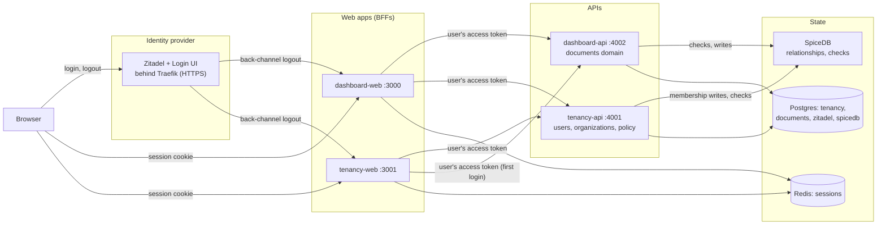

# auth-stack-exercise

A small identity platform, built as an exercise: a self-hosted OpenID Connect provider (Zitadel) owns identities and sessions, a Zanzibar-style authorization service (SpiceDB) owns permissions, a tenancy service owns organizations and their members, and two web applications are thin clients of all three.

Users sign up or log in once, see a dashboard of the documents they may view, edit the ones they may edit, and never see the ones they may not. Everything runs from one `docker compose` command. TypeScript monorepo: Next.js for the web apps, Fastify for the APIs, shared packages for the parts every service needs.

This file is the whole story at reading length: what the system is, how it is built, how to run and try it, what was traded off or left undone, and what is built versus planned.

The complete design with its reasoning is [`docs/README.md`](docs/README.md), which also describes parts that are planned and not built; the work log with a status per ticket is [`docs/TICKETS.md`](docs/TICKETS.md); each service and package has a `README.md` of its own. Every "§n" in this file links to that section of `docs/README.md`.

## What it does

- **Sign up and log in** through Zitadel's login page (password; passkeys and MFA are offered by Zitadel but not required). A first login creates the user's personal workspace: a "Personal" organization and project with a "Welcome" document.
- **Three visibility states on one dashboard**, decided per document by SpiceDB: editable, read-only, or absent. The seeded scenario (an "Acme" organization with three users) shows all three at once.
- **Editing is enforced on the server**: the save endpoint re-checks the permission; a forged request gets `403` for a document the user may only view and `404` for one they may not see, and both are replayable with `curl`.
- **Sharing** a document with a member of its organization, as viewer or editor, from the dashboard.
- **Organizations** managed in a second application: members, their roles, and the organization's sign-in policy (stored; enforcement is planned, see the gaps).
- **Single sign-on and single sign-out between the two applications**: a login on one is a login on the other, and a logout on one ends the other's session through OpenID Connect back-channel logout.
- **Consistency done deliberately**: every write to a document stores the permission snapshot it was made under, every read of that document checks against it, and the New Enemy problem of the Zanzibar paper is reproduced in a test and shown to be closed.

## Architecture



### How a request flows

The browser talks only to a web app. Each web app is a backend-for-frontend: it holds the user's tokens in a server-side session in Redis and gives the browser an opaque session cookie (`HttpOnly`, `SameSite=Lax`); no token ever reaches the browser.

The web app calls the APIs with the user's access token. Each API verifies the token locally against Zitadel's JWKS (issuer, expiry, audience), checks that the calling application was granted the scope the route needs, then asks SpiceDB whether this user may do this action on this resource, and only then touches its database. Every decision is made on the server, on the write path; buttons and links in the UI are hints.

### Who owns what

Zitadel owns credentials, the identity provider session, and token issuance; the apps never see a password. SpiceDB owns every permission decision: who is an admin or member of an organization, who owns, edits, or views a project, who a document was shared with; roles are named permission bundles in its schema ([`packages/authz/schema.zed`](packages/authz/schema.zed)).

`tenancy-api` owns users, organizations, membership, and the organization's sign-in policy; `dashboard-api` owns projects and documents. Each API owns its database; nothing shares a table. The two web apps own nothing but their sessions.

### Login

Authorization code with PKCE (`S256`), `state` and `nonce` kept in a signed, short-lived cookie, the ID token validated by `openid-client`, the session created server-side with the claims the app needs (`sub`, `sid`, `auth_time`, `amr`), and a just-in-time provisioning call that creates the user's record and personal workspace, idempotently, on the first login from any app.

The authorization request carries `max_age` equal to the session's absolute lifetime, so a stale identity-provider login is re-authenticated rather than accepted.

Logout deletes the session, revokes the refresh and access tokens at Zitadel (verified end to end: the refresh token is refused afterwards), and ends the Zitadel session too. Zitadel notifies every application of a sign-out through back-channel logout tokens, which each app validates and acts on.

### Consistency

SpiceDB answers checks from a cached snapshot that can lag a write by a few seconds. A write to a document runs its permission check at full consistency and stores the returned snapshot token (a ZedToken) with the content, in the same transaction; every read of that document checks "at least as fresh as" that token, so a revocation that preceded a write can never be missed when the write is read.

Listings run from the cache on purpose, so a document shared with you a moment ago may take a few seconds to appear; the page behind the link is exact at once. [§7](docs/README.md#7-consistency-zedtokens-and-the-new-enemy-problem) explains the reasoning and the two designs that were tried and rejected first.

## Repository structure

```text
apps/
  bootstrap/      one-shot: writes the SpiceDB schema, runs every package's migrations, configures Zitadel
                  (project, applications, seeded users), grants client scopes, seeds the Acme scenario,
                  writes each app's configuration to .local/config/; idempotent, re-run on every start
  dashboard-web/  Next.js BFF: login, the dashboard, edit and share pages; owns only its sessions
  dashboard-api/  Fastify resource server for the documents domain
  tenancy-web/    Next.js BFF: organizations, members, sign-in policy; the second OIDC client
  tenancy-api/    Fastify: users mirror, organizations, membership, policy; provisioning on first login
packages/
  auth/           OIDC client, session store interface (memory and Redis), login/logout/back-channel sink,
                  bearer verification and scope gate for the APIs; Next.js and Fastify adapters
  authz/          SpiceDB schema, client, and typed check/lookup/write helpers with explicit consistency
  client-scopes/  client authority (which application may call which API scope), stored in SpiceDB;
                  a labelled workaround for Zitadel's missing custom scopes
  db-core/        Postgres connection factory and migration runner, no tables
  tenancy/        the tenancy service's schema, migrations, services, and HTTP client
  documents/      the documents domain's schema, migrations, services, and HTTP client
  config/         shared tsconfig and ESLint presets
docker/           Postgres init script, the TLS generator, and the compose README (ports, profiles, volumes)
docs/             README.md (the complete design), TICKETS.md (the work log)
docker-compose.yml, Tiltfile, .env (committed development defaults), .github/workflows/ci.yml
```

## Design decisions

- **An identity provider rather than hand-rolled authentication.** Password storage, recovery, MFA, lockout, and verification are Zitadel's; the apps are OpenID Connect clients. The depth of the authentication work is in the client and session handling, not in a password table. Zitadel over Kratos + Hydra (one binary with a login UI, organizations, external-IdP brokering, a full management API) and over Keycloak (heavier). [§2](docs/README.md#2-approach-in-one-sentence), [§4.1](docs/README.md#41-why-zitadel).
- **OIDC for first-party apps, from day one.** A single first-party app does not strictly need OAuth, but an identity layer conceived without token audiences, scopes, and client registration is painful to retrofit when the first machine client or partner integration arrives. [§2](docs/README.md#2-approach-in-one-sentence).
- **SpiceDB over OpenFGA**, for its consistency model: a snapshot token with four explicit levels, instead of a flag. The project's consistency section is where that choice earns its place. Relationships are the only source of truth for roles; nothing stores a role in Postgres. [§6.1](docs/README.md#61-why-spicedb), [§7](docs/README.md#7-consistency-zedtokens-and-the-new-enemy-problem).
- **Tenancy as its own service.** Organizations, users, and policy are needed by every domain, so they live in a higher-order service the domains call, with its own database and its own front-end, rather than in whichever domain happened to need them first. [§3.1](docs/README.md#31-components-and-ownership).
- **Policies enforced by the apps, not the identity provider.** One account can belong to several organizations with different sign-in requirements, and the IdP cannot know at login which one a session will touch (the GitHub organizations model), so a tenant's floors are evaluated when a request touches its resources, with step-up re-authentication as the remedy.
  - This keeps the IdP replaceable; it also costs the ability to block a session before it exists.
  - Enforcement is planned (ticket 24); storage and the form exist. [§9.1](docs/README.md#91-authentication-context-policies-live-in-the-apps).
- **Scopes enforced from the first version of every API**, so that external clients can be added later without touching the APIs. Zitadel has no custom scopes or consent, so client authority is stored in SpiceDB behind an interface and resolved by the access token's `client_id` claim (RFC 9068; Zitadel's access tokens carry no `azp`); a loud disclaimer marks it as a vendor workaround. [§6.7](docs/README.md#67-client-authority-scopes).
- **Each API validates tokens locally** against the JWKS, with a 10-minute access-token lifetime bounding the window in which a revoked token is still accepted; introspection is the switch for an API that cannot tolerate that window. [§4.4](docs/README.md#44-login-flow-what-packagesauth-implements).
- **One hostname per application** (`dashboard.localtest.me`, `tenancy.localtest.me`, `auth.localtest.me`), because browsers scope cookies by host and ignore the port: two apps on `localhost` would overwrite each other's sessions, which would break single sign-on. The identity provider is served over HTTPS because its login keeps its session in a `Secure` cookie. [§4.3](docs/README.md#43-the-issuer-and-host-problem).
- **Compose as the reviewer path, Tilt as the developer loop**, and no third way to run the project; the test suites run against whichever is up. Kubernetes is a planned phase. [§11](docs/README.md#11-phase-plan).

## Running it

### Prerequisites

- Docker with Compose v2 and BuildKit, Docker Engine 25 or Docker Desktop 4.27 or newer (the Dockerfiles use `# syntax=docker/dockerfile:1.7-labs`).
- The Docker socket at `/var/run/docker.sock` (Traefik reads it; rootless Docker, Podman, and Colima need the socket path changed in `docker-compose.yml`).
- Free ports 3000, 3001, 8025, 8443 on all interfaces and 5432, 6379, 50051 on `127.0.0.1`.
- DNS: `localtest.me` and its subdomains resolve to `127.0.0.1` in public DNS, so no hosts entry is needed unless your resolver blocks answers of `127.0.0.1` (some corporate resolvers do) or you are offline, in which case add `127.0.0.1 auth.localtest.me dashboard.localtest.me tenancy.localtest.me` to `/etc/hosts`.

Nothing else: no Node and no setup step for the compose path.

### Everything in compose

From the repository root:

```sh
docker compose --profile apps up -d --wait --build   # first run: several minutes (two Next.js builds, three API builds), then about a minute from a clean state
docker compose logs bootstrap                        # one JSON line per object created, found, or updated; ends with "done"
docker compose --profile apps down -v                # stop and wipe: fresh Zitadel instance and databases on the next up
```

Then **trust the development certificate once**: the first start generates a certificate authority in `.local/tls/` and Zitadel is served at `https://auth.localtest.me:8443` with a certificate it signed. Import `.local/tls/ca.crt` as a trusted root in your browser (macOS: `security add-trusted-cert -r trustRoot -k ~/Library/Keychains/login.keychain-db .local/tls/ca.crt`, used by Safari and Chrome; Firefox and Chrome on Linux import it in their own certificate settings).

Clicking through the browser's warning also works, as long as that browser has never trusted the CA: Zitadel sends `Strict-Transport-Security`, which browsers honour once they have seen the site with a trusted certificate, after which there is no way past a warning on that host. The CA survives `down -v`; deleting `.local/` makes the next start generate a new one.

### Tilt

Tilt is the developer loop: the infrastructure runs in compose, bootstrap runs as a step, and the apps run on the host with hot reload. Tool versions are pinned in `mise.toml` (Node, pnpm, Tilt) and installed with [mise](https://mise.jdx.dev):

```sh
mise trust && mise install && pnpm install
mise exec -- tilt up   # UI at http://localhost:10350
tilt down              # removes the containers, keeps the volumes (--delete-volumes wipes them)
```

Run one stack at a time; they share the apps' ports.

### Trying it

The seeded scenario is an "Acme" organization with a Marketing project ("Launch plan", "Budget") and a Finance project ("Payroll"). Password `Password1!` for every seeded user, emails verified:

| User | Role in the scenario | Dashboard |
| --- | --- | --- |
| `alice@example.com` | Acme admin | Every Acme document, all editable |
| `bob@example.com` | Acme member, Marketing editor | Marketing documents editable; Finance absent |
| `carol@example.com` | Acme member, Marketing viewer, "Launch plan" shared to her directly | "Launch plan" editable, "Budget" read-only, Finance absent (the reviewer's user: all three states at once) |

| What | Where |
| --- | --- |
| `dashboard-web` | `http://dashboard.localtest.me:3000`: Log in → `/dashboard`; Edit, Share, Log out |
| `tenancy-web` | `http://tenancy.localtest.me:3001`: `/organizations`, members and policy for an organization you administer |
| Zitadel login and console | `https://auth.localtest.me:8443`; console at `/ui/console`, admin `zitadel-admin@zitadel.auth.localtest.me` / `Password1!` |
| Mailpit (every email Zitadel sends) | `http://localhost:8025` |
| APIs | `tenancy-api` on `4001`, `dashboard-api` on `4002`: published on the host under Tilt only; bearer-token routes, exercised through the apps and the tests; `GET /health` is public |
| Postgres, Redis, SpiceDB | `127.0.0.1:5432`, `:6379`, `:50051` (preshared key `dev-preshared-key`); `pnpm authz:zed schema read` prints the schema bootstrap wrote |

Things to try: log in as Carol and compare her dashboard with Alice's; log in on `tenancy-web`, then open `dashboard-web` and click Log in, and land on the dashboard with no prompt; log out on either and watch the other's next request go to the login; as Alice, share "Payroll" with Bob from the dashboard and see it appear read-only on his a few seconds later.

**Sign-up:** on Zitadel's login page choose "Register new user"; the registration form preselects *Passkey* as the method, so pick *Password* unless you have a passkey device; no verification email is sent and none is required (Zitadel's registration as configured here accepts the address unverified, see the gaps), and the first login lands on a dashboard with the new personal workspace.

**A forged request:** with a session cookie, the matching `Origin` header, and the session's `csrf_token` (every form carries it as a hidden field), a `curl` POST to `/documents/<id>` on `dashboard-web` answers `303` for a document the user may edit, `403` for one they may only view, `404` for one they may not see, and `403` before any lookup without the token; the same three answers come from `tenancy-web`'s member and policy forms.

Every response of the web apps carries a nonce-based Content Security Policy and the other security headers of [§9](docs/README.md#9-security-posture-the-configuration-profile); every response of the APIs the JSON set. Bootstrap is idempotent: every start re-runs it, a second run creates nothing, and it puts the seeded roles and shares back, so the scenario survives an edit session. The seeded IDs and the users' Zitadel IDs are in `.local/config/seed.json`.

### Tests

Three suites, each named after what it needs running; CI (`.github/workflows/ci.yml`) runs all three, plus lint, formatting, type-check, `zed validate` on the schema, compose validation, and Gitleaks.

```sh
pnpm lint && pnpm format:check && pnpm type-check
pnpm test                                # unit (Jest): nothing running
pnpm test:integration                    # Jest, *.integration.test.ts: either stack running; the packages that own a database create and drop their own
pnpm exec playwright install chromium    # once
pnpm test:e2e                            # Playwright against the compose stack with the apps profile (test:e2e:tilt against Tilt, where the dev server relaxes the CSP)
pnpm authz:validate                      # zed validate on the schema, in a container
```

The end-to-end suites log in as each seeded user through Zitadel's real login page and check the dashboard against the table above, edit a document and put it back, replay the forged POSTs, prove single sign-on and sign-out between the two apps, share a document and watch the other user's listing catch up, exercise the member and policy forms, and verify that a logout revokes the refresh token at Zitadel.

Playwright's report after a failure: `pnpm exec playwright show-report apps/dashboard-web/playwright-report`.

## Trade-offs, shortcuts, and gaps

Stated in full because the exercise asked for them. Each is deliberate; the reasoning is in the section cited.

**Trade-offs taken on purpose.**

- Development secrets are committed in `.env` (Zitadel master key, admin password, SpiceDB preshared key, session secret, database passwords) so the stack starts with no setup step; every value is labelled insecure and a real deployment injects them from a secret store. The infrastructure ports are published on the loopback interface only. [§9](docs/README.md#9-security-posture-the-configuration-profile).
- The bootstrap container runs every package's database migrations before seeding, because the apps start after it; the migrations stay owned by their packages, bootstrap only executes them. [§3.1](docs/README.md#31-components-and-ownership).
- APIs validate access tokens locally, so a token revoked at Zitadel is accepted until it expires, at most 10 minutes; introspection would close the window at a call per request. [§4.4](docs/README.md#44-login-flow-what-packagesauth-implements).
- Listings are served from SpiceDB's cached snapshot (`minimize_latency`), so a share or a revocation can take a few seconds to show on a dashboard; content reads are exact per row through the stored snapshot token. A listing right after your own write is exact because the dashboard asks for a listing at least as fresh as the row you wrote. [§7.3](docs/README.md#73-the-design-a-token-stored-with-every-piece-of-content-levels-chosen-per-operation).
- All applications share one Zitadel project, so a token issued to one application is valid at every API of the solution; the per-API control is the scope grant, not the audience. The per-resource audience model is described for a provider that supports it. [§4.2](docs/README.md#42-deployment-shape), [§6.6](docs/README.md#66-cross-domain-access).
- Zitadel is served over HTTPS with a self-issued development CA, with the browser trust step above; the apps stay on plain HTTP, so their session cookies carry `Secure` only when the app URL is HTTPS and no `__Host-` prefix. [§4.3](docs/README.md#43-the-issuer-and-host-problem), [§9](docs/README.md#9-security-posture-the-configuration-profile).
- Sessions, including the tokens, are stored in plaintext in an unauthenticated Redis on the development stack. Containers run as root where Zitadel's reference compose does; Traefik reads the Docker socket. All compose-only.

**Vendor workarounds, each labelled in the code.**

- Zitadel has no custom scopes and no consent screen, so client authority (which application may call which API scope) is stored in SpiceDB and resolved by the access token's `client_id` claim (`packages/client-scopes`). It exists so the APIs enforce scopes from their first version; with a provider that emits `scope`, the package is deleted and nothing else changes. [§6.7](docs/README.md#67-client-authority-scopes).
- Zitadel's access tokens carry no `amr`, `auth_time`, or `acr`, so authentication-context policies cannot be enforced at the APIs; the design enforces them at the web app from the ID-token claims it holds in the session. [§9.1](docs/README.md#91-authentication-context-policies-live-in-the-apps).
- `devMode` is on for the applications because they use plain-HTTP redirect URIs on hosts other than `localhost`; it turns off with an HTTPS app URL.

**Gaps, with the ticket that specifies the work.**

- **The web apps are registered as public OIDC clients** (PKCE, no client authentication) although a server-side BFF is a confidential client by definition and holds refresh tokens. What protects them today is Zitadel's refresh-token rotation and the server-side session store.
  - The fix is additive, private-key JWT client authentication with the credential handed over by bootstrap, and is ticket 4a.
  - Found by an independent review on 2026-10-19; the design had specified PKCE and never named the client authentication method.
- **No document creation.** Documents come only from the seeds and from provisioning; the schema has no creation permission below the organization. Ticket 19b.
- **Sign-in policies are stored, not enforced.** The policy form in `tenancy-web` (require MFA, maximum login age, required identity provider) writes to tenancy; nothing reads it yet, so ticking "require MFA" changes nothing at login. The `requireAuthContext` helper and the step-up flow are ticket 24.
- **No invitations.** Joining an organization is by seed or by an administrator changing an existing member's role; the uniform-response invitation flow of [§6.8](docs/README.md#68-discovery-and-invitations) is ticket 17a. Self-registration accepts an unverified email address, so the invitation flow must require a verified email before it matches an invitee by address.
- **A missed back-channel logout is not backed up.** If a logout token never arrives (the app was down), the session lives until its idle or absolute limit, and Zitadel keeps honouring the refresh token after `end_session` (observed); re-validation of the identity-provider session on an interval is ticket 20a.
- **No audit log of authorization decisions.** Ticket 22.
- **No rate limits** on the APIs' mutations, the login callback, or the back-channel sink (which does bound its request body). Ticket 23a.
- **Session claims are not re-read after a token refresh** (`sid`, `auth_time`, `amr`), which matters only if the provider rotates `sid` on re-authentication.
  - The refresh lock is per process, so two instances behind a balancer could race the rotation.
  - A refresh that Zitadel refuses ends in an error page rather than a login, because Zitadel answers a revoked refresh token with `invalid_request` where RFC 6749 [§5.2](docs/README.md#52-documents-domain-packagesdocuments-database-documents) prescribes `invalid_grant`, the code the app treats as "session over". Tickets 8a and 8b.
- **No "log out everywhere"** page, although the session store supports it. Ticket 20b.
- **Provisioning reaches across domains from the web apps** (a first login on either app calls both tenancy and the documents API); the pattern that avoids it is a spike, ticket 10a.
- The Tilt-based test run is not in CI (ticket 13b); the comments domain, observability, Kubernetes, an API gateway, and brokering a second identity provider are later phases (tickets 26 to 32).

## What is built and what is planned

Tickets in their intended order of implementation; numbers are stable identifiers, so the order is the list, not the number. The reasoning for the order is [§11](docs/README.md#11-phase-plan); each ticket's notes are in `docs/TICKETS.md`.

### Phase 0, foundation

| Ticket | What | Status |
| --- | --- | --- |
| 0 | Design documents and working agreement | Done |
| 1 | Monorepo scaffold and the CI checks | Done |
| 2 | Compose infrastructure | Done |
| 3 | Zitadel spike: one real login from inside compose | Done |
| 4 | Bootstrap container | Done |
| 5 | Tiltfile and the CI integration job | Done |

### Phase 1, the vertical slice

| Ticket | What | Status |
| --- | --- | --- |
| 6 | SpiceDB schema and `packages/authz` | Done |
| 7 | `db-core`, `tenancy`, `documents` packages | Done |
| 8 | `packages/auth`: OIDC client, sessions in Redis | Done |
| 15 | Bearer verification and the scope gate | Done |
| 16 | `tenancy-api` | Done |
| 9 | `dashboard-web` shell: login, logout, protected routes | Done |
| 10 | Just-in-time provisioning and the personal workspace | Done |
| 11 | Dashboard with the three states and the edit flow | Done |
| 12 | Seeds: the Acme scenario | Done |
| 13 | Playwright suite: login and edit for the three users | Done |
| 13a | The test suites against Tilt | Done |
| 13b | The Tilt suites in CI | Open |
| 14 | This README | This file |

### Phase 2, services

| Ticket | What | Status |
| --- | --- | --- |
| 19a | `dashboard-api` | Done |
| 17 | `tenancy-web`: organizations, members, policy | Done |
| 17b | TLS at Traefik for Zitadel | Done |
| 18 | Back-channel logout sink | Done |
| 19 | `dashboard-web` over HTTP to `dashboard-api` | Done |
| 20 | Single sign-on and sign-out end to end | Done |
| 19b | Document creation | Open |
| 17a | Invitations with a uniform response | Open |
| 4a | Confidential clients: private-key JWT client authentication | Open |

### Phase 3, consistency and audit

| Ticket | What | Status |
| --- | --- | --- |
| 21 | Listings at `minimize_latency` and the New Enemy tests | Done |
| 21a | Read your own write on the dashboard | Done |
| 22 | Decision audit log | Open |

### Phase 4, hardening

| Ticket | What | Status |
| --- | --- | --- |
| 23 | CSRF tokens, security headers, CSP | Done |
| 23a | Rate limits | Open |
| 24 | Sign-in policies and the step-up flow | Open |
| 20a | Re-validation of the IdP session, the backstop for a missed logout | Open |
| 8a | Session claims re-read after a token refresh | Open |
| 8b | Refresh lock across instances | Open |
| 8c | A refused refresh ends the session | Open |
| 20b | Log out everywhere | Open |
| 25 | Coverage pass and input-validation audit | Open |
| 10a | Provisioning without cross-domain calls from the BFFs (spike) | Open |

### Phase 5, the comments domain

| Ticket | What | Status |
| --- | --- | --- |
| 26 | Zitadel Actions spike: RFC 9068 claims in access tokens | Open |
| 27 | `comments-api` | Open |
| 28 | `comments-web` and the cross-domain test | Open |

### Phases 6 to 9

| Ticket | What | Status |
| --- | --- | --- |
| 29 | OpenTelemetry tracing | Open |
| 30 | Kubernetes | Open |
| 31 | API gateway | Open |
| 32 | Broker a second identity provider | Open |

## Further reading

- [`docs/README.md`](docs/README.md) for the complete design and its decision log.
- [`docs/TICKETS.md`](docs/TICKETS.md) for every ticket with its notes.
- [`docs/oidc-sso-checklist.md`](docs/oidc-sso-checklist.md) for the OIDC/SSO checklist the 2026-10-19 review of `packages/auth` used, with a preamble on how it was produced.
- [`docker/README.md`](docker/README.md) for what each container is for.
- The package READMEs: [`auth`](packages/auth/README.md), [`authz`](packages/authz/README.md), [`client-scopes`](packages/client-scopes/README.md), [`db-core`](packages/db-core/README.md), [`tenancy`](packages/tenancy/README.md), [`documents`](packages/documents/README.md).

## How this project was built

The design was decided first and written down (`docs/README.md`), then implemented ticket by ticket on feature branches merged with merge commits, so the history is the record.

Coding agents (Claude Code) wrote the code and drafted the documents from that design, in small steps that were reviewed, with every open design question brought back for a decision before implementation; independent review agents working from the documentation reviewed the code, the schema, and the OIDC handling against the specifications, and their findings are recorded in the decision log and the gaps above. The verification is the test suites and CI, not the author of any line.
