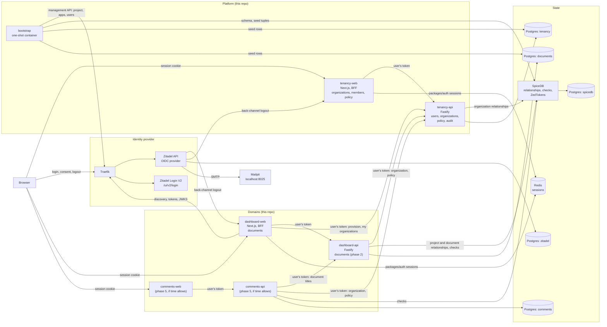

# Auth Stack Exercise — Architecture & Context

> **📜 Design/decision log.** This folder is the planning artifact for the project. The body is kept current: a correction rewrites the paragraph or table it affects, so that each section is accurate on its own, and the decision log (§12, append-only and chronological) records what changed and, when it matters, what the text said before; `docs/TICKETS.md` keeps per-ticket dated notes as the record of how each ticket went. The root `README.md` is the human-readable version of this document for someone running and reviewing the project, and it is kept in sync at the end of every phase.

> **Read this first.** This document is the shared context for every ticket and PR in this repository (`docs/TICKETS.md`). It captures the problem, the architecture, the authorization model, the consistency model, the deployment shape, the security posture, and the phase plan, so any ticket can be picked up without re-deriving context.

## 1. Problem

The system is a web application that authenticates users through a login page and, based on fine-grained permissions, lets them edit values on resources: some resources are editable, some are read-only, and some do not appear at all. Its authentication is secure, its authorization system is scalable, and the whole thing runs from a single `docker compose up`, so anyone can log in as different users and see different dashboards. The design is production-ready and the documentation is honest about it, including a list of trade-offs, shortcuts, and gaps. The design does not limit how the system can be extended, and it answers extension questions of the form "how would you add X" (enterprise SSO, provisioning, machine clients, custom roles, multi-region, swapping a component); §10 collects those answers.

## 2. Approach in one sentence

The system is a small identity platform: a self-hosted OpenID Connect provider (Zitadel) owns identities and sessions, a Zanzibar-style authorization service (SpiceDB) owns relationships and permission checks, and the application layer (a Next.js dashboard acting as a backend-for-frontend, later a Fastify API) is a thin, replaceable client of both, built from shared packages that any future service in the estate would reuse.

### Why not hand-rolled authentication

Two decisions hide in "how do users log in", and they are independent.

The first is **who handles credentials**: password storage, recovery, verification, MFA, lockout, rate limiting, breach response. Framework-provided authentication (Devise, Django's auth, Laravel's) runs fine in production for years, so "never hand-roll" is too strong. What grows with scale is the long tail around the password hash: recovery and verification flows, MFA enrolment and reset, account linking, lockout and credential-stuffing defences, audit. A dedicated identity system, bought or self-hosted, owns that tail; this project delegates it to Zitadel. The depth of the authentication work then shows in the integration surface: the OIDC client and BFF (PKCE, `state`, `nonce`, ID-token validation, cookie attributes, session lifecycle), the resource server's audience checks, just-in-time provisioning, and the threat model in §9.

The second is **how applications talk to that system**, and here OIDC is not the automatic answer. OAuth 2.0 and OIDC are a delegated-authorization framework, not a login protocol: Ory's [Before you use OAuth2](https://www.ory.com/docs/hydra/concepts/before-oauth2) puts the cases where they fit as third-party access to user data, machine-to-machine authorization, heterogeneous device fleets, and an existing investment in an OIDC product, and the cases where you likely do not need them as login, registration, recovery, social sign-in, and a new single-page or mobile app backed by your own API. For a handful of first-party apps on one domain, an identity system plus a session cookie is the simpler production shape, and it is the shape headless systems such as Ory Kratos are built for.

### Why OIDC for first-party applications here

This project still makes its first-party apps OIDC clients, for a reason that comes from experience rather than principle: an identity layer conceived without token audiences, scopes, and client registration is painful to retrofit when the first partner integration, machine client, or public API arrives, because every app's notion of "who is calling" has to change at once. Starting from one provider and OIDC clients makes those concepts exist from day one, at the cost of a redirect-based login and a BFF holding tokens. The non-OIDC alternative is available in the same stack: Zitadel's Session API lets a first-party app drive login directly and share a session cookie, which is what a custom login UI (phase 8) would use. Both shapes are documented so the trade-off is explicit instead of assumed.

## 3. Architecture



### 3.1 Components and ownership

| Component | Role | Owns | Source |
| --- | --- | --- | --- |
| Zitadel (`zitadel-api` + `zitadel-login` behind Traefik) | OpenID Provider: registration, login, MFA, password reset, IdP sessions, tokens, JWKS, back-channel logout, external IdP brokering | Identities and credentials, in its own Postgres database | Off the shelf, pinned image |
| SpiceDB | Authorization: relationships, `CheckPermission`, `CheckBulkPermissions`, `LookupResources`, ZedTokens; one schema partitioned by domain | Relationship tuples, in its own Postgres database | Off the shelf, pinned image |
| Redis | Session store behind the `SessionStore` interface of `packages/auth`, shared by every BFF | Application sessions (not IdP sessions) | Off the shelf, pinned image |
| `apps/tenancy-api` (phase 1) | The higher-order platform API every domain relies on: users mirror, organizations, their authentication-context policy, organization membership, just-in-time provisioning, the decision audit log | The `tenancy` database and the organization level of the SpiceDB schema | This repo |
| `apps/tenancy-web` (ticket 17) | End-user management of organizations over `tenancy-api` with the user's token: the organizations a user may view, the member list every member sees (§6.8), and, for an administrator, role changes, removals, and the policy settings of §9.1; the second OIDC client, on `packages/auth` and its `next` adapter with its own application and cookie, which is what proves single sign-on and single sign-out (ticket 20). No database and no SpiceDB connection: it holds nothing the API does not | Its session cookie and pages | This repo |
| `apps/dashboard-web` | The documents product: login redirect, session, dashboard, edit form; a BFF that holds tokens server-side and calls `dashboard-api` and `tenancy-api` with them, with no database and no SpiceDB connection of its own | HTTP session cookie, page rendering, enforcement on its own write paths | This repo |
| `apps/dashboard-api` | Resource server for the documents domain behind bearer tokens (ticket 19a): the listing, the edit page's read, the content write, the share action, and the personal workspace, each over `packages/documents` with the scope gate of §6.7 in front; what the BFFs call for every documents operation, and the one place that checks SpiceDB for documents | The `documents` database and the project/document level of the SpiceDB schema | This repo |
| `apps/comments-web` and `apps/comments-api` (phase 5, if time allows) | A second domain, comments on documents: proves cross-domain data access | The `comments` database and the comment level of the schema | This repo |
| `apps/bootstrap` | One-shot, idempotent container: configures Zitadel (project, applications, seeded users), writes the SpiceDB schema, seeds the tenancy and documents databases and the relationship tuples | Nothing at runtime; it hands generated configuration to the apps through a shared volume | This repo |
| `packages/auth` | Platform package: OIDC client for BFFs (discovery, PKCE, `state`, `nonce`, token validation), the `SessionStore` interface with in-memory and Redis adapters, the back-channel logout sink, bearer verification and the `ScopeResolver` for APIs, the authentication-context policy helper; framework-agnostic core with thin `next` and `fastify` adapters | The one place OIDC and session details live | This repo |
| `packages/authz` | Platform package: SpiceDB client, the schema file, typed check/lookup/write helpers, consistency handling | The one place SpiceDB details live | This repo |
| `packages/client-scopes` | Platform package: the client-authority workaround of §6.7, the `api_scope` grant helpers and the SpiceDB-backed `ScopeResolver`, kept out of `packages/authz` so that it can be deleted as a unit when the provider emits `scope`; imported by the APIs and bootstrap only | The client-to-scope grants, as tuples in SpiceDB | This repo |
| `packages/db-core` | Platform package: Postgres connection factory and migration runner; no tables | | This repo |
| `packages/config` | Shared tsconfig and ESLint presets | | This repo |
| `packages/tenancy` | Domain package of the tenancy service: Drizzle schema, migrations, and services for users, organizations, policy, and audit (package root, imported only by `tenancy-api` and bootstrap); the typed HTTP `TenancyClient` and its types on the subpath `@auth-stack/tenancy/client`, which is what domain packages and BFFs import | The tenancy database | This repo |
| `packages/documents` | Domain package: schema, migrations, and services for projects and documents (package root, imported by `dashboard-api` alone, plus bootstrap for migrations and seeds); the API's HTTP client, wire format, scope vocabulary, and the values rule on the subpath `@auth-stack/documents/client`, which is what the BFFs import | The documents database | This repo |
| `packages/comments` (phase 5) | Domain package for comments; imported only by `comments-api` | The comments database | This repo |
| Mailpit | SMTP sink with a web UI at `localhost:8025` | Nothing | Off the shelf |

Three ownership rules shape the layout. **One service owns each database**, so domain packages are never shared across services, and a domain's schema travels with its services in one package. **Tenancy is a platform concern, not a domain**: organizations, users, and policy are needed by every domain, so they live in their own service that the domains call rather than in whichever domain happened to need them first. **Platform packages carry no domain tables**; `packages/auth` does not even assume a database: its `SessionStore` is an interface, and the host picks the adapter. One deliberate bend: in compose, the bootstrap container runs every package's migrations before seeding, because the apps start after it; the migrations stay owned by their packages and bootstrap is only the executor. The IdP and the authorization service are separate processes with separate databases, so they scale, fail, and upgrade independently, and either can be swapped (Zitadel for Auth0 or Keycloak; SpiceDB for OpenFGA) without touching the other.

### 3.2 One place per concern

Each identity concern lives in exactly one place, so that no application team has to hold the whole OIDC checklist and no component has to be rewritten when another changes: the **identity provider** (Zitadel) owns credentials, IdP sessions, and token issuance; the **in-app OIDC client** (`packages/auth`) is reduced to configuration plus a session store and is the only code that knows the protocol; the **authorization service** (SpiceDB, through `packages/authz`) owns every permission decision; the **written contract** every client follows is the configuration profile in §9; and two pieces are described for later rather than built now, an **API gateway** that validates bearer tokens in front of the APIs (until then each Fastify API validates its own) and a **session-status service** that centralizes logout propagation and revocation queries once there are more BFFs than a per-app sink can reasonably serve.

## 4. Identity: Zitadel

### 4.1 Why Zitadel

- OIDC-native (certified OP), ships a login UI with registration, password reset, MFA, and external-IdP brokering, so the login page required by the problem exists without writing one, and a custom login UI remains possible later through its Session API.
- Organizations, projects, and applications map directly onto a multi-tenant product; identity providers can be registered per organization, which is how enterprise SSO would be added (§10).
- A full management API, so the bootstrap container can configure everything; nothing is clicked in a console.
- Single Go binary plus Postgres; runs comfortably inside the reviewer's compose stack.
- Alternatives considered: Ory Kratos + Hydra (headless, so a login UI must be written, and two services instead of one); Keycloak (capable, heavier Java deployment, larger surface); Auth0 or WorkOS AuthKit (managed, cannot run inside `docker compose up`); hand-rolled (see §2). Zitadel is licensed under the AGPL, which an organization would weigh before adopting; it does not affect this project.

### 4.2 Deployment shape

The compose stack starts from Zitadel's own v4 reference compose: Traefik in front, `ghcr.io/zitadel/zitadel` (API) and `ghcr.io/zitadel/zitadel-login` (Login V2, a Next.js app served under `/ui/v2/login` on the same origin), Postgres behind. TLS terminates at Traefik: a one-shot container generates a development CA and a certificate for Zitadel's hostname into `.local/tls/` at first start, Traefik serves it on the one published entrypoint, and Zitadel runs with `ZITADEL_EXTERNALSECURE=true` behind it, speaking plain h2c to the proxy. The reason is Login V2's own session: it lives in a cookie set with the `Secure` attribute, fixed in the image, which a browser stores only on an HTTPS origin; without it every login completes but nothing persists at the IdP, so there is no single sign-on and no single sign-out to propagate. Everything that calls Zitadel from Node trusts the CA through `NODE_EXTRA_CA_CERTS`, the browser suites ignore the certificate error, and a reviewer imports the CA once (root README). The apps stay on plain HTTP, which is why their applications keep Zitadel's dev mode (§4.3). Login V2 is required in v4; the API container is configured with `ZITADEL_DEFAULTINSTANCE_FEATURES_LOGINV2_REQUIRED=true` and the `ZITADEL_OIDC_DEFAULTLOGINURLV2`/`DEFAULTLOGOUTURLV2` URLs, and the login container authenticates to the API with a login-client PAT that the API writes to a shared volume at first start (`ZITADEL_FIRSTINSTANCE_LOGINCLIENTPATPATH`). Pinned version: `v4.19.4` (the current release at the time of writing; Zitadel's own `.env.example` pins `v4.16.0`, and the spike in ticket 3 falls back to that tag if `v4.19.4` misbehaves).

The first instance is created by environment variables (`ZITADEL_FIRSTINSTANCE_*`), including a **machine user with a PAT written to the shared bootstrap volume** (`ZITADEL_FIRSTINSTANCE_PATPATH`, `ZITADEL_FIRSTINSTANCE_ORG_MACHINE_MACHINE_USERNAME`, `..._ORG_MACHINE_PAT_EXPIRATIONDATE`). The bootstrap container reads that PAT and uses the management API to create the project, the OIDC application, and the seeded users. Zitadel generates the OIDC client ID, so the bootstrap container writes the generated values (client ID, issuer) to the shared volume as an env file that `dashboard-web` sources at start. SMTP points at Mailpit through `ZITADEL_DEFAULTINSTANCE_SMTPCONFIGURATION_SMTP_HOST=mailpit:1025` (with `..._TLS=false`, `..._FROM`, and `ZITADEL_DEFAULTINSTANCE_DOMAINPOLICY_SMTPSENDERADDRESSMATCHESINSTANCEDOMAIN=false`), so verification and reset emails are visible at `http://localhost:8025`.

**One Zitadel project for the whole solution.** A project is Zitadel's security context for one software solution, and it is the unit of token audience: a JWT access token's `aud` holds the project ID plus the client IDs of every application in the project. All applications (`dashboard-web`, `tenancy-web`, `dashboard-api`, `tenancy-api`, and later `comments-web` and `comments-api`) live in that one project, so any user-bound token issued to a client of the solution is valid at any API of the solution, which is what Zitadel intends and what the apps rely on (§6.6). Zitadel's own authorization features (project roles, role assignments, "check role assignment on authentication", project grants, organization login policies) are not used: SpiceDB owns authorization, and the apps own policy (§9). One default organization exists because the instance needs one. Confirmed with a user's token (ticket 16): before any API application existed, `aud` held `dashboard-web`'s client ID and the project ID; once bootstrap registered `tenancy-api` as an API application, its client ID joined the list on the next token. The APIs check the project ID only, so registering an API changes nothing in verification; it is what makes the API a member of the project in Zitadel's own terms. With a provider that models audiences per resource instead (RFC 8707 resource indicators; Auth0's "APIs" with an `audience` parameter), each API would be its own audience and each client would request the audiences it needs at login; the apps would not change, only the bootstrap.

### 4.3 The issuer and host problem

Zitadel validates that requests arrive for its configured external domain (`ZITADEL_EXTERNALDOMAIN`, `ZITADEL_EXTERNALPORT`, `ZITADEL_EXTERNALSECURE` must match the public URL, or it answers "Instance not found"), and OIDC requires the issuer string the browser is redirected to and the issuer the server discovers to be identical. In compose the browser reaches Zitadel at `localhost:8080` while the app containers reach it by service name, which breaks both. Three candidates were weighed; the spike of ticket 3 settled on the first:

- **(a) One hostname for everyone.** Use a loopback DNS name such as `auth.localtest.me` (resolves to `127.0.0.1` publicly) as `ZITADEL_DOMAIN`, publish Traefik on the host, and give the app containers `extra_hosts: ["auth.localtest.me:host-gateway"]` so the same URL works from inside containers. Simplest; requires public DNS resolution on the machine running the stack (fine for laptops and CI runners). **This is the design.** The container maps `auth.localtest.me` to the host gateway and reaches Traefik's published port, so discovery, the browser redirect, the token exchange, and the ID token's `iss` all use `https://auth.localtest.me:8443` (HTTPS since ticket 17b, §4.2; the containers trust the development CA that signed the certificate). Two constraints came out of the spike: the application needs Zitadel's dev mode for an `http://` redirect URI on a host other than `localhost`, which the apps still register since they stay on plain HTTP, and `redirect_uri` must come from configuration, because a standalone Next.js server reports its own bind address in `request.url`.
- **(b) Keep `localhost` and override the host.** App containers call Traefik by service name with a `Host: localhost:8080` header; `openid-client` v6 exposes a custom fetch hook that makes this possible. No DNS dependency, more code in `packages/auth`. Not taken.
- **(c) Trusted domains.** Zitadel's own mechanism for accepting requests under additional hostnames: an instance-level list (`ZITADEL_FIRSTINSTANCE_TRUSTEDDOMAINS` at setup) that is not used for routing but "can appear in API responses like OIDC discovery". That last property is the risk to test: if discovery or minted tokens reflect the internal hostname as the issuer, the browser-facing and container-facing issuers differ and the option is out. Zitadel's compose and custom-domain guides only restate the invariant (the three external settings must match the public URL; the instance is selected from the request `Host`), so this would have had to be settled empirically. Not taken.

The apps use the same loopback scheme with one hostname each, `dashboard.localtest.me:3000`, `tenancy.localtest.me:3001`, `comments.localtest.me:3002`, because browsers ignore the port when scoping cookies: two BFFs on `localhost` with different ports would overwrite each other's session cookies, which would break single sign-on and sign-out between them. Each app's hostname is what its redirect URI registers. For local development with Tilt, the apps run on the host (`local_resource`) while only the infrastructure runs in compose, which sidesteps the problem entirely; the reviewer path (everything in compose) is the one that has to be solved.

The same scheme applies in the other direction. Zitadel resolves a back-channel logout URI's hostname at registration time and refuses one it cannot resolve, and an app's compose service name is not in DNS before the app starts, which is after bootstrap. So every application registers its **public** URL as `backchannel_logout_uri` and `zitadel-api` maps each app hostname to the host gateway (`extra_hosts`), reaching the app through the port compose publishes, or the port a Tilt-run app listens on. One URL per app, the same in both run paths. Zitadel's outbound HTTP client denies private and loopback destinations by default (its SSRF guard); the compose stack narrows that list to the link-local range, which a real deployment would not.

### 4.4 Login flow (what `packages/auth` implements)

1. `GET /auth/login` builds an authorization request: `response_type=code`, `scope=openid profile email offline_access`, PKCE `S256` (RFC 7636), fresh `state` and `nonce`, stored in a short-lived, signed, `HttpOnly` cookie; redirect to the authorization endpoint found through discovery.
2. Zitadel's login UI handles registration, password, MFA, and (later) external IdPs; it redirects back to `GET /auth/callback?code&state`.
3. The callback verifies `state`, exchanges the code with `code_verifier`, validates the ID token (`iss`, `aud`, `exp`, `nonce`, signature against JWKS) through `openid-client`, and creates a **server-side session** through the `SessionStore`: session ID, `sub`, `sid`, the tokens, the ID token's `auth_time` and `amr` (the authentication evidence used by §9), idle and absolute expiry. The browser gets only an opaque session ID in a cookie: `HttpOnly`, `Secure` (except on plain-HTTP localhost), `SameSite=Lax`, `Path=/`.
4. Just-in-time provisioning (§6.4) runs on the first login of a `sub`.
5. `POST /auth/logout` deletes the session and redirects to the `end_session_endpoint` with `id_token_hint` and a registered `post_logout_redirect_uri`, so the IdP session ends too.
6. `POST /auth/backchannel-logout` receives Zitadel's logout token (OpenID Connect Back-Channel Logout 1.0), posted as a form, server to server: validated like an ID token (signature against the JWKS from discovery, `iss`, `aud` containing the client ID, `exp`, and `iat` required), then on what makes it a logout token: `events` with `http://schemas.openid.net/event/backchannel-logout`, a `sid` or `sub`, and no `nonce`, which is also what refuses an ID token replayed here; the sink calls `deleteByLogoutToken({ sid, sub })`, which removes every session matching the claims present, and answers `200` with no body, `400` to a request without a valid token, `500` when the store fails, never a redirect; no cookie and no origin check, since no browser is involved. Zitadel posts the token to the `backchannel_logout_uri` of every application that obtained tokens in that IdP session, not to every registered application, both when the user signs out through `end_session` and when the session is terminated through its session API (an administrator, `DELETE /v2/sessions/{id}`), within a second in this stack; the token is `RS256`, `typ: JWT`, `aud` the client ID alone, 15 minutes long, with `jti`, `sid`, and `sub` all set (observed 2026-10-18). A replayed token can only remove what its first delivery removed, so no `jti` cache is kept. Nothing backs up a notification that never arrives: no re-validation of the IdP session runs on an interval, and the token refresh of step 7 is no backstop either, since Zitadel keeps honouring a refresh token after `end_session` ended the session that issued it (observed 2026-10-18: accepted five seconds after the sign-out, on the token's first use), so a BFF session that missed its logout token lives until its idle or absolute expiry (thirty minutes and eight hours, the store's defaults). The backstop is ticket 20a.
7. Access tokens never reach the browser. A BFF attaches the session's access token when calling an API, refreshing with the refresh token when expired (rotation and reuse detection are the IdP's job).

**`SessionStore` is an interface**, not a table, modelled on the `sessionStore` option of Auth0's [`nextjs-auth0`](https://github.com/auth0/nextjs-auth0) SDK (`get`, `set`, `delete`, an optional atomic `update`, and `deleteByLogoutToken` for back-channel logout): here `create`, `get`, `touch`, `update`, `delete`, `deleteByLogoutToken({ sid, sub })`, `deleteByUser` (admin revocation), `listByUser`. One detail taken from that SDK's documentation is that `touch`, the sliding-expiry update, must be a single conditional operation (a Lua script on Redis, `UPDATE ... WHERE id = $1` on SQL), never a `get` followed by a `set`: otherwise a rolling write in flight during a logout recreates the session the logout just deleted. `update(id, patch)`, how a refreshed token pair is stored, has the same shape: it writes only to a session that still exists, reports whether it did, and resets the idle expiry, and there is no upsert, so neither a rolling write nor a refresh can recreate a session a logout removed; both are one Lua script on Redis. Refreshes are deduplicated per session within a process, and a refused refresh re-reads the session before it is given up, because Zitadel rotates refresh tokens and a render fans out. Two adapters ship: in-memory for tests and **Redis** for everything else. Redis gives native expiry (idle timeout as a TTL refresh, absolute lifetime as a stored field) at the cost of two secondary indexes the adapter maintains (`sid → session`, `user → sessions`) and of persistence that must be enabled or a restart logs everyone out; each BFF prefixes its keys, since the apps share one Redis and those indexes must stay per app. A relational adapter would be a drop-in; it would need an expiry cleanup job or a partial index on `expires_at`, and it would gain trivial listing and revocation queries. The core of `packages/auth` works on the Fetch API's `Request`/`Response` and depends only on `openid-client` and `jose`; `@auth-stack/auth/next` and `@auth-stack/auth/fastify` are thin adapters, so the package assumes neither a framework nor an ORM.

**APIs validate access tokens locally.** Zitadel issues JWT access tokens when the application's "Auth Token Type" is JWT; a resource server verifies the signature against JWKS, `iss`, `exp`, and that `aud` contains the project ID, with no network call per request. Introspection (RFC 7662, with the API application's own credentials) is the alternative Zitadel's guides lean on: one call per request, but it also catches revoked tokens and reports whether the caller is in the audience. The design takes local validation for latency and is explicit about the window it leaves: a token the IdP has invalidated stays valid at the API until its `exp`. The access-token lifetime is set to 10 minutes on the Zitadel applications to bound that window; introspection closes it entirely at the cost of a call per request, and is the setting to flip for an API whose operations cannot tolerate it.

## 5. Tenancy and resource domains: data model

Tenancy is the platform service; two resource domains sit on it. The first domain is deliberately simple yet hierarchical enough for relationship-based access control to earn its place: **organization → project → document**, where the organization belongs to tenancy and the rest to the domain. The second, **comments on documents** (phase 5, if time allows), exists to prove data access across domains.

### 5.1 Tenancy (`packages/tenancy`, database `tenancy`)

| Table | Columns (abridged) | Notes |
| --- | --- | --- |
| `users` | `id` (Zitadel `sub`, PK), `email`, `display_name`, `created_at` | Mirror created just-in-time at first login; the IdP is the source of truth |
| `organizations` | `id`, `name`, `is_personal`, `owner_id` (set for personal organizations; partial unique index enforces one per user), `policy` (JSON: `require_mfa`, `max_auth_age_seconds`, `require_idp`), `created_at` | No consistency token: organizations are not content that is read under a permission check (§7.3). `is_personal` marks the organization that provisioning creates for each account (§6.4): `tenancy-web` shows it as "Personal", offers no member management, policy form, or independent leave/delete for it, and the one allowed transition is converting it to a shared organization. The flag exists so that personal and shared content share one hierarchy and one code path; the alternative, personal projects owned directly by the user with no organization above, would need a second listing and policy path. It is not a security boundary: SpiceDB decides access identically for both. `policy` holds the tenant's authentication-context floors (§9.1) |
| `invitations` (ticket 17a) | `id`, `organization_id`, `email`, `role` (`admin` or `member`), `token_hash`, `expires_at`, `created_by`, `accepted_at` | One row per invitation; the token travels only in the email link and is stored hashed (§6.8) |
| `authz_decisions` (phase 3) | `id`, `at`, `subject`, `action`, `resource_type`, `resource_id`, `organization_id`, `allowed`, `consistency`, `request_id`, `latency_ms` | Audit log of decisions from every service (§8) |

### 5.2 Documents domain (`packages/documents`, database `documents`)

| Table | Columns (abridged) | Notes |
| --- | --- | --- |
| `projects` | `id`, `organization_id` (by value; the organization lives in tenancy), `name`, `is_personal`, `created_at` | `is_personal` marks the "Personal" project provisioning creates in each personal organization (§6.4); a partial unique index on `(organization_id) WHERE is_personal` allows one per organization, which is what makes `ensurePersonalProject` idempotent and race-safe |
| `documents` | `id`, `project_id`, `organization_id` (denormalized for filtering), `name`, `value_1`, `value_2`, `zedtoken`, `updated_at`, `updated_by` | The "values" the problem statement asks to edit; `zedtoken` is the permission snapshot stored with the content, written in the same transaction as every content change and share (§7.3) |

### 5.3 Comments domain (`packages/comments`, database `comments`, phase 5)

| Table | Columns (abridged) | Notes |
| --- | --- | --- |
| `comments` | `id`, `document_id` (by value), `organization_id`, `author_id`, `body`, `zedtoken`, `created_at` | References a document it does not own; the title is fetched from `dashboard-api` (§6.6); `zedtoken` as on documents (§7.3) |

Sessions live in Redis behind `packages/auth` (§4.4), not in a domain database. Membership and roles are **not** stored in Postgres: they are relationships in SpiceDB. Tenancy stores organizations and policy; the domains store content; SpiceDB stores who may do what. Keeping one source of truth per concern avoids the dual-write drift that follows from storing roles in both places.

## 6. Authorization: SpiceDB

### 6.1 Why SpiceDB

- A faithful Zanzibar implementation: relationships, schema with computed permissions, `LookupResources` for "what can this user see", and **ZedTokens** with explicit consistency semantics per request (§7). This is the property the design leans on.
- Postgres datastore, single binary, runs in compose; gRPC API with an official Node client (`@authzed/authzed-node`).
- Caveats give a path to attribute-based rules without leaving the relationship model.
- Alternatives: **OpenFGA** (the same model with an HTTP API and a DSL; wider adoption; its consistency control is a per-request `HIGHER_CONSISTENCY` flag rather than a snapshot token, which is the discriminating difference for this design); **Ory Keto** (the Zanzibar model, but the project has moved slowly, and a production deployment I have seen stayed pinned to an alpha release for years because upgrading an authorization store that every product path depends on is hard: the cost of choosing the wrong engine); application-side RBAC tables (simple, but every new resource type or sharing rule becomes a schema migration and a code path, and nothing answers "list everything I can see" efficiently).

### 6.2 Schema

```zed
definition user {}

definition organization {
    relation admin: user
    relation member: user

    permission administer = admin
    permission view = admin + member
    permission create_project = admin + member
}

definition project {
    relation organization: organization
    relation owner: user
    relation editor: user
    relation viewer: user

    permission administer = owner + organization->administer
    permission edit = owner + editor + organization->administer
    permission view = owner + editor + viewer + organization->administer
    permission share = administer
}

definition document {
    relation project: project
    relation editor: user
    relation viewer: user

    permission edit = editor + project->edit
    permission view = viewer + editor + project->view
    permission share = project->share
}

// Client authority (§6.7): one object per API scope; bootstrap grants scopes to first-party clients.
definition client {}

definition api_scope {
    relation grantee: client

    permission invoke = grantee
}

// Phase 5: the comments domain extends the same schema and resolves through the documents domain.
definition comment {
    relation document: document
    relation author: user

    permission view = document->view
    permission edit = author
    permission delete = author + document->edit
}
```

Design points. Organization **members** do not see projects by inheritance; only organization **admins** do. That is what makes a project "unavailable" to a member who was not added to it, which the problem statement requires. Project roles flow down to documents; direct document shares (`document#editor`, `document#viewer`) allow the read-only and editable states to differ inside one project. Roles are named bundles of relations rather than a `role` relation with string values, so a new role is a schema change reviewed like code, and permissions stay computable by `LookupResources`. `share` is the permission the share action checks (granting a project role or a direct document share; ticket 21 uses it); it is defined as its own permission rather than having callers test `administer` so that it can be widened later, for example to let editors share what they edit, in one schema line with no caller changed. Permissions are named after actions, roles after people.

Four things a reader familiar with SpiceDB will look for, stated so they are decisions rather than omissions. Only project administrators (project owners and organization admins) can share, including a document that was shared to a single editor: Carol can edit "Launch plan" but cannot share it, because `document.share = project->share` and `project.share = administer`. Role relations admit only `user`, so every grant is per person; a `group` definition with `| group#member` on the role relations is the documented way to grant to sets, and it is a relation-shape change (relationships reference relations, not permissions), so it is named in §10 rather than added now. There is no root object above `organization`, so a platform operator who must reach every organization has no place in the model; the documented shape is a `platform` definition with `super_admin` and `organization#platform` arrows, also left to §10. Naming follows the documentation's conventions, relations as nouns (`grantee`, not `granted`) and permissions as verbs; `use` was avoided as a permission name because it is a schema directive keyword. The committed `schema.zed` carries doc comments (`/** ... */`) on every definition, relation, and permission, and enables `use typechecking` with full annotations if the pinned SpiceDB version accepts it; this document shows the schema without them for brevity.

### 6.3 Seeded scenario

| User | Password (dev only) | Relationships | Dashboard |
| --- | --- | --- | --- |
| `alice@example.com` | `Password1!` | `organization:acme#admin@user:alice` | Every document in Acme, all editable |
| `bob@example.com` | `Password1!` | `organization:acme#member@user:bob`, `project:marketing#editor@user:bob` | Marketing documents editable; Finance project absent |
| `carol@example.com` | `Password1!` | `organization:acme#member@user:carol`, `project:marketing#viewer@user:carol`, `document:launch-plan#editor@user:carol` | "Launch plan" editable (direct share), "Budget" read-only, Finance absent |

Acme has two projects, Marketing ("Launch plan", "Budget") and Finance ("Payroll"). The structural relationships that make the arrows in §6.2 fire are seeded with them: `project:marketing#organization@organization:acme`, `project:finance#organization@organization:acme`, and `document:<id>#project@project:<id>` for each of the three documents. Carol is the reviewer's user: her dashboard shows all three states at once. Each seeded user also gets a personal workspace on first login (§6.4). The password policy is Zitadel's default (8+ characters with upper, lower, digit, symbol); seeded users are created with verified emails so no Mailpit step is needed to log in.

Bootstrap seeds the scenario on every run, after the migrations and after the users exist in Zitadel (their IDs are the `sub`s the relationships name). Each domain writes its own part (§6.6): the `users` mirror rows, Acme (`policy` `{}`), and the organization roles through `packages/tenancy` (`seedOrganization`), then the projects, the documents, the structural relationships, the project roles, and the direct shares through `packages/documents` (`seedDocuments`), tenancy first so that Acme's roles are older than the token the documents seed stores on every document (§7.3). The rows have fixed UUIDs (`5eed0000-0000-4000-8000-0000000000nn`), so the names above are labels, not identifiers; `.local/config/seed.json` lists the organization's ID and, by label (`marketing`, `finance`, `launch-plan`, `budget`, `payroll`), the projects' and documents', next to the users' Zitadel IDs, for the end-to-end tests. The documents start as "Launch plan" (`Launch window`, `Q1`), "Budget" (`Approved spend`, `120000`), and "Payroll" (`Pay run`, `Monthly`), with Alice as their writer. A re-run creates nothing and changes no value, writer, or policy, but TOUCHes every relationship and replaces every seeded document's token with the write's, so a share removed by hand, or a `sub` that changed when the Zitadel volume alone was reset, is repaired by the next run (the tuples of an old `sub` stay behind, harmless, until the volumes are wiped). Because the mirror rows are seeded, a seeded user's first login never exercises `tenancy-api`'s userinfo fetch (§6.4); an account registered on the login page is the path that does.

### 6.4 Just-in-time provisioning and the sign-up story

A user who registers through Zitadel's login UI arrives at the callback with a `sub` the platform has never seen. Every BFF's login callback makes the same two idempotent calls with the user's token, as the `onLogin` hook of `@auth-stack/auth/next`, after the session is created and before its cookie is set, on every login (both calls are idempotent, so the BFF has no "first login" test of its own). A failure of either deletes the session again and the login fails with the generic response, so there is no session without its provisioning, and the next login runs the calls again.

**First, tenancy's `provisionUser`** (`POST /me/provision` on `tenancy-api`, through the `TenancyClient` interface; an in-process implementation exists for unit tests). `tenancy-api` takes `sub` from the access token; when no `users` row exists for it, and only then, it fetches `email` and `name` from the IdP's userinfo endpoint with the same token (verified by the IdP rather than trusted from the caller's body; bootstrap hands the URL to the APIs from discovery, `OIDC_USERINFO_URL` in `apis.env`); then it inserts the `users` row and creates the personal organization, each create-if-absent on its own key, and writes the organization's tuples (`organization:<id>#admin@user:<sub>`). The mirror is written once, from what the IdP answered: a later change of email or name at the IdP is not mirrored, the IdP stays the source of truth, and nothing reads the mirror for authorization. A userinfo refusal of the token answers `401` like any invalid token; an unreachable userinfo answers `502`, and the login fails rather than provisioning with unverified data.

**Second, the documents domain's `ensurePersonalProject`** (`POST /organizations/:id/personal-project` on `dashboard-api`, through the `DocumentsClient` of `@auth-stack/documents/client`), which creates the "Personal" project with one example document, "Welcome", writes their tuples (`project:<id>#organization@organization:<id>`, `document:<id>#project@project:<id>`), and stores the relationship write's token on the document row (§7.3). Each domain writes only its own part of the schema (§6.6), so "one transaction" means one per database, each idempotent. Both BFFs make this call (`tenancy-web` needs `documents:write` for it, §6.7), so a user whose first login is on `tenancy-web` has a workspace before they ever open the dashboard.

Both steps key on the absence of what they create (the personal organization, the personal project), never on the `users` row, so a user seeded into a shared organization still gets a personal workspace on first login. The calls are **idempotent**, create-if-absent and otherwise return the existing user, so it runs once per login rather than once per BFF, reads stay free of side effects, and concurrent calls (two BFFs seeing the same new user at once, or a misbehaving client calling repeatedly) converge: `users.id` is the primary key with `INSERT ... ON CONFLICT DO NOTHING` and a read of the winner, a partial unique index on `organizations (owner_id) WHERE is_personal` forbids a second personal organization, the same kind of index on `projects (organization_id) WHERE is_personal` forbids a second personal project, and the SpiceDB writes use `TOUCH` semantics so repeating them is a no-op.

JIT beats IdP webhooks or actions for this: it cannot be missed, needs no inbound connectivity to the app, and gives the first dashboard a document: the hook returns the landing path `/dashboard?created=<welcome document id>` when it created the workspace, the dashboard lists at least as fresh as that row (§7.3), so the first render shows it, and says the workspace is ready. That every BFF reaches into the documents domain for it, and that every further app would copy the two calls, is the question ticket 10a's spike settles before a third app exists.

### 6.5 Enforcement points

- **Dashboard:** one `LookupResources(document, view, user:<sub>)` call, join the returned IDs to `documents` rows, then one `CheckBulkPermissions` request checking `edit` and `share` for every row, all at `minimize_latency`, the listing level of §7.3 (phase 1 listed at `fully_consistent`; ticket 21 moved listings to their level). `view` decides whether the row is shown at all; `edit` decides between "Edit" and "Read-only"; `share` whether "Share" is offered. The links are hints.
- **Edit form (GET) and save (POST):** `CheckPermission(document:<id>, edit, user:<sub>)` on the server before reading (`at_least_as_fresh` with the row's token) or writing (`fully_consistent`, storing the returned token with the content; §7.3). A user who posts a crafted request for a document they can only view gets `403`; one who posts for a document they cannot see gets `404` (no existence leak).
- **`dashboard-api` (ticket 19a):** the same checks behind HTTP, over the same service: `GET /documents` is the dashboard's listing (`?fresh_as=<document id>` lists at least as fresh as that row's token, for the user who just wrote it, §7.3), `GET /documents/:id` the edit page's read (`403` for a user who may only view, `404` for one who may not see), `PUT /documents/:id` the save, `PUT /documents/:id/shares` the share action (§6.8), `GET /documents/:id/shares` the share page's read of what the last share left (ticket 21), and `POST /organizations/:id/personal-project` the workspace of §6.4, each after the scope gate of §6.7 (`documents:read` on the reads, `documents:write` on the writes). An error answers `{ "error": <code> }` and nothing else. `dashboard-web` is a BFF in the strict sense (ticket 19): it keeps the OIDC client, the session (cookie, Redis, refresh), CSRF and headers, rendering, and the authentication-context evaluation that must sit there (§9.1), and has neither `packages/documents`' root nor `packages/authz` nor any database connection except Redis. Every documents operation is an HTTP call to `dashboard-api` through the `DocumentsClient` of `@auth-stack/documents/client` with the user's access token (refreshed by `packages/auth` when it is about to expire, §4.4 step 7), and the API is the only place that checks SpiceDB for documents. The BFF validates the edit form with the same values rule the service enforces, exported by that subpath, so a bad body never leaves it; the API's refusals become the pages' states: `401` sends the user to log in again (the BFF session is left to its own expiry), `403 forbidden` is the read-only page, `404` the not-found page, and any other answer, a `400 invalid_input` included, surfaces as a failure, since the two sides share one rule and a disagreement is a bug. The phase 1 arrangement, where the web app called the service layer in-process, existed only to reach the minimum viable submission on one process.

### 6.6 Cross-domain access

When `comments-api` needs something about a document, three different questions have three different answers.

- **"May this user view document X?"** is asked of SpiceDB directly: `CheckPermission(document:X, view, user:<sub>)`, at `fully_consistent` when posting a comment (the returned token is stored on the comment) and otherwise at the level §7.3 gives for the operation; the document's own token is the documents domain's to use, not the comments domain's. The comments schema references the documents schema (`comment#document@document`), so `comment.view` resolves through `document->view` without any call to `dashboard-api`. Permission questions never cross service boundaries as HTTP calls.
- **"What is document X's title?"** is data, and it travels on the **user's own access token**: `comments-api` calls `dashboard-api` with the token it received, `dashboard-api` validates it (same project, so the audience is satisfied by construction) and runs its own SpiceDB check on `sub`. The user's identity and session evidence stay attached to the request end to end. Across security contexts (a different Zitadel project, or a different provider's resource) this would be token forwarding with the wrong audience, the confused-deputy pattern; within the solution's single project it is the intended model, and the README says which is which.
- **Calls with no user** (a nightly job, a reconciliation) use a Zitadel **service user** (private-key JWT profile, or client credentials for simplicity), requesting the project audience. The receiving API authorizes the service identity itself, through relationships on a `service:<id>` subject, and never a user the caller claims to act for.

The same rules govern every call into `tenancy-api`, and they resolve cleanly because almost every such call happens on behalf of a user:

| Call | Caller | Carries | Authorization inside `tenancy-api` |
| --- | --- | --- | --- |
| Provision me | a BFF, from the login callback | the user's token | the `sub` in the token is the subject; nothing else is needed |
| Read an organization (name, policy) | domain APIs and BFFs | the user's token | SpiceDB `organization#view` for `sub`; a non-member gets `404`; cached by the caller for a minute per user and organization, misses included, since the answer is a permission decision for that user and reusing it for another would show a non-member what a member sees; a fresh membership becomes visible to that user within a minute, or at once through `invalidate(sub)` |
| Membership and policy changes | `tenancy-web` | the user's token | `organization#administer` |
| Calls with no user | the calling API's own identity (client credentials) | its own token | the scope gate (§6.7): the one in scope is each API posting audit decisions to `POST /decisions` with scope `audit:write` (phase 3) |

Each service writes only the part of the SpiceDB schema it owns: tenancy writes organization relationships, each domain writes its own (project roles, document shares, comments). Each domain stores the permission snapshot with its own content and uses it on its own reads (§7.3); no token crosses a service boundary.

Token exchange (RFC 8693) is the textbook alternative for the second case: trade the user's token for one minted for the target API, optionally with an `act` claim naming the calling service. Zitadel supports the grant but only to keep or narrow a token's audience and scope; it cannot broaden a token from one project to another, so cross-project audiences must be requested at login with `urn:zitadel:iam:org:project:id:{projectId}:aud`. Inside one project the exchange adds nothing except the `act` claim, which requires granting impersonation rights; it is documented, not built.

### 6.7 Client authority: scopes

Two authorities have to hold for every API request, and they come from different places. **Client authority** is what the application was granted (RFC 6749 §3.3 scopes), at registration for first-party clients and at user consent for third-party ones. **User authority** is what the person may do, which SpiceDB decides. The effective permission is their intersection, and the API enforces both, in that order: the bearer plugin checks the scope first (`requireScope('documents:write')`, failing with `403` and `WWW-Authenticate: Bearer error="insufficient_scope"` per RFC 6750 §3.1), then the handler runs the SpiceDB check on `sub`. Without the first gate, any client that obtains a user's token holds the user's full authority, which is exactly what scopes exist to prevent once external clients appear.

Each API publishes a scope vocabulary and enforces it from its first version, so that external clients can be added later without touching the APIs:

| API | Scopes |
| --- | --- |
| `tenancy-api` | `tenancy:read`, `tenancy:write` |
| `dashboard-api` | `documents:read`, `documents:write` |
| `comments-api` | `comments:read`, `comments:write` |

First-party clients are granted the scopes of the calls they make, so for them the gate is always open: `dashboard-web` holds both scopes of both APIs; `tenancy-web` holds both of `tenancy-api` and `documents:write` alone, for the one documents call of its login (§6.4). A third-party client requests the subset it needs and the user consents to it; a token exchange can only narrow the set further.

> **⚠️ Disclaimer: this is a workaround for a vendor limitation, not the intended design.** Client authority belongs in the authorization server: the provider defines the scopes, shows the consent screen, and puts the granted `scope` in the access token, and the API reads it from there. Zitadel does neither (see the vendor gap below), so this project stores client-to-scope grants in SpiceDB and resolves them by the token's `client_id`. It does this for one reason: so that the APIs enforce a scope gate from their first version and never have to be retrofitted when the stack grows third-party clients. The moment the provider emits `scope`, the `fromScopeClaim` resolver replaces the SpiceDB-backed one and the `client`/`api_scope` tuples are deleted; the APIs do not change.

**Where client authority is stored (under this workaround).** In SpiceDB, like every other "who may do what" fact, with the client as the subject: `api_scope:documents_write#grantee@client:<client_id>`, the object ID being the scope string with `:` replaced by `_`, since SpiceDB object IDs cannot contain a colon. Bootstrap writes those relationships for every first-party client, one per scope its calls need; registering a new client is one more set of tuples. There is no per-API client registry: the bearer plugin resolves a client's effective scopes with one `LookupResources(api_scope, invoke, client:<client_id>)`, cached per client for a minute because client authority changes rarely, and the APIs share that single store.

**How `packages/auth` resolves scopes without owning the store.** Through an interface, as with sessions: `ScopeResolver.resolveScopes(claims) → Set<string>`. Two implementations: `fromScopeClaim`, for providers that put `scope` in access tokens, and the SpiceDB-backed resolver of `packages/client-scopes`, which runs the lookup above and is wired in by the API at startup, so `packages/auth` depends on neither SpiceDB nor a database.

**Vendor gap.** Zitadel does not, as far as its documentation and community threads show, support custom scopes or a consent screen, and its claims matrix shows no `scope` claim in any token type; its JWT access tokens carry `client_id` (RFC 9068) and no `azp`, which appears only in its ID tokens, with `at_hash` (verified against a real token in ticket 15; both token types have header `typ: JWT`, so the bearer plugin tells them apart by claims: `client_id` required, `at_hash` and `nonce` refused). So with Zitadel the SpiceDB-backed resolver keyed by `client_id` is the only source of client authority. Zitadel can register third-party applications and issue them user tokens, but without consent and scopes it cannot run a real third-party program; that would take a provider that does (Auth0, Keycloak) or a second authorization server such as Ory Hydra federated to Zitadel for login. Because the APIs already enforce the gate and the store is central, that is a provider change, not an API change, which is the point of building the gate now.

### 6.8 Discovery and invitations

**Who a user can share with is scoped to the organization.** A project role or a direct document share can be granted only to a member of the organization that owns the resource, and the picker in the UI is that organization's member list from `tenancy-api` (visible to every member, as in GitHub or Slack). The share endpoints accept member IDs, never emails, so a share can never be used to probe for accounts outside the organization. The first one is `PUT /documents/:id/shares` of `dashboard-api` (ticket 19a): it replaces the document's direct shares with the set it receives (`editors`, `viewers`, by `sub`), for a caller with `document#share`; every named user is checked as `organization#view` on the owning organization, and a failure answers `400 not_a_member` whether the account exists or not, which keeps the endpoint useless for enumeration. `dashboard-web`'s share page (`/documents/[id]/share`, ticket 21) is that picker: the owning organization's members from `tenancy-api`, the user left out, each with the direct access they hold on the document, none, viewer, or editor, read through `GET /documents/:id/shares` at the row's token (§7.3), and a form that posts the whole set to the BFF's same-origin route, which `PUT`s it. Project roles are neither shown nor changed there. The dashboard offers "Share" on a row where the listing's bulk check allowed `document#share`, a hint like "Edit"; the page and the route check again.

**Membership is changed, never granted, from the member list.** `tenancy-web`'s organization page (ticket 17) shows every member the list, and an administrator the controls to make a member an administrator, make an administrator a member, or remove either; each is `PUT /organizations/:id/members` on `tenancy-api` with the member's `sub` and the new role or `null`, behind `organization#administer`. The API refuses a `sub` that holds no role (`400 not_a_member`): a first role comes only from an invitation (below) or the seed, so the route cannot be used to add an account by ID, and the UI has no add-member form. It also refuses to demote or remove the last administrator (`409 last_admin`), so an organization never ends up with nobody who can manage it. Both rules are decided on the organization's relationships read at full consistency, and the change is one atomic SpiceDB write. A personal organization (§5.1) has no membership to manage (`409 personal_organization`).

**Joining an organization goes through invitations, with a uniform response.** An organization admin enters an email in `tenancy-web`; `tenancy-api` stores an invitation (organization, email, role, a hashed random token, expiry) and sends one email through the configured SMTP (Mailpit in this stack) containing a link to `tenancy-web`'s accept page. The UI answers "invitation sent" whether or not an account with that email exists, the member list does not change until the invitee acts, and the email reads the same in both cases: the link leads to login, which is also sign-up through Zitadel's login UI, and on return the accept page validates the token, checks that the signed-in account's email matches, writes `organization#<role>@user:<sub>`, and marks the invitation accepted. Expired or already-used tokens fail identically.

Invitations are rate-limited, because an endpoint that sends email on request is otherwise an email-bombing and enumeration-by-volume tool: limits apply per inviting user and per organization (how many invitations in a window), and per target address (a cooldown before the same email is sent again). Exceeding a limit answers `429` to the authenticated admin; it never changes the uniform response for a given address. The concrete windows and the implementation (`@fastify/rate-limit` keyed on user and organization, plus a per-address timestamp on the invitation row) are left to ticket 17a.

The uniform response is the point. "Add member by email of an existing account" would be smaller, but its success or failure tells an admin whether an account exists, and a 403-only mitigation ("only admins can probe") is a limit on who can enumerate, not a fix. Invitations also give the later enterprise story its seam: directory provisioning (§10) replaces the human invitation with an automated one and writes the same tuples.

## 7. Consistency: ZedTokens and the New Enemy problem

### 7.1 What a check reads

SpiceDB answers a check from a **snapshot** of the relationship data, and by default (`minimize_latency`) that snapshot is served from cache. To make caching work across many requests, SpiceDB divides time into windows, the *quantization interval* ([`--datastore-revision-quantization-interval`](https://authzed.com/docs/spicedb/concepts/consistency), five seconds by default, pinned at that value in compose), and serves every check inside a window from one snapshot, under one cache key. On the Postgres datastore that snapshot is the first transaction committed at or after the window's start; until one lands, checks read the head (observed on 2026-10-19 with the pinned version: a write that is the first of its window is visible at `minimize_latency` at once, a later one in the same window not until the next). SpiceDB may also keep serving a window's snapshot for a tenth of the interval after it ends (`--datastore-revision-quantization-max-staleness-percent`, `0.1` by default), chosen per call. The price is that a default check can be stale by up to roughly one window, that tenth, and cache propagation: seven seconds is the bound the tests use.

That staleness is the **New Enemy problem** from the Zanzibar paper, in two forms. *Neglecting update order:* Alice removes Bob from a project and then adds a document; a check served from the snapshot between the two still lets Bob see the new document. *Applying an old ACL to new content:* Bob is removed, content is added, and Bob's check against the older snapshot passes. The window is seconds, not minutes, and for most reads that is acceptable; for a write it is not, because a write is exactly where a stale allow becomes a real action.

### 7.2 What a ZedToken is

A ZedToken is an opaque marker of a datastore revision (SpiceDB's name for Zanzibar's *zookie*). Every `WriteRelationships` and `DeleteRelationships` returns the token of the revision after the write; checks can return one too. Passed back on a request as `at_least_as_fresh`, it tells SpiceDB "answer from a snapshot no older than this revision": if the cached snapshot is already that fresh, the answer still comes from cache; if not, SpiceDB reads the datastore. It is a precision instrument for freshness, not a way to reduce reads, and it is opaque by contract: clients cannot compare two tokens or take the newer of them, which is why a check can carry only one.

The four consistency levels, from cheapest to most expensive: `minimize_latency` (cached snapshot, possibly stale by one window); `at_least_as_fresh(token)` (cached if fresh enough, otherwise a datastore read); `at_exact_snapshot(token)` (that exact revision, for paginating a stable view; fails once the revision is garbage-collected); `fully_consistent` (bypasses the cache and reads the head revision; on CockroachDB this still does not guarantee read-after-write, which is why the Authzed documentation prefers `at_least_as_fresh` there, while on the Postgres datastore used here it does).

### 7.3 The design: a token stored with every piece of content, levels chosen per operation

The pattern is the one the Zanzibar paper describes and Authzed's write-up of the New Enemy problem spells out ([*New Enemies*](https://authzed.com/blog/new-enemies), the section "I Did It All for the Zookie"; [*Storing ZedTokens*](https://authzed.com/docs/spicedb/concepts/consistency#storing-zedtokens)): **every piece of content carries the permission snapshot it was written under**. A content write first runs its permission check at `fully_consistent`; that check returns a ZedToken; the content and the token are stored in the same transaction (`documents.zedtoken`, `comments.zedtoken`). Every later read of that content checks with `at_least_as_fresh(row.zedtoken)`, so the read can never be served from a snapshot older than the permissions that protected the write. That is the guarantee against the second New Enemy case, and the post states it exactly: the system "will never give access to a version of the content to which the user has had their access revoked" before that version was written. Shares and role grants on a document also store their returned token on the row (the post's optional variant), so the grantee's first read is not a false negative while the grant propagates.

What the per-row token does not promise is worth stating, because it is where an earlier version of this design went wrong. A revocation that happens *after* the last content write is ordinary revocation latency: a `minimize_latency` read may honour the old permission for up to one quantization window, and only `fully_consistent` closes that, at the cost of the cache on every read. The token orders permission changes relative to **content** changes; it is not a mechanism for making every later membership change visible everywhere, and nothing has to "fan out" to other rows when membership changes.

| Operation | Consistency | Token |
| --- | --- | --- |
| Read one document (the edit page; later the API's `GET /documents/:id`) | `at_least_as_fresh(documents.zedtoken)` | Read from the row with the content |
| Change one document's content (`PUT`) | `fully_consistent` for the `edit` check: a mutation is the "select circumstance" where a revocation moments ago must already apply, and the check's token is what gets stored | The check's returned token is stored with the content in the same `UPDATE` |
| Share or grant on a document | `fully_consistent` for the `share` check; the relationship write's returned token replaces the row's token | The write |
| Listings (`LookupResources`, bulk `edit` and `share` for the dashboard) | `minimize_latency`, always | None: a listing carries one consistency setting for many rows, so no per-row token applies, and Authzed's guidance for lists is not to try ("don't!"): a listing exposes names, and every content read is gated per row with its token |
| Read a document's shares (the share page; `GET /documents/:id/shares`) | `at_least_as_fresh(documents.zedtoken)` for the `share` check and for the relationship read | Read from the row: the last share stored its token, so the set read is the one it left |
| A listing for the user who just wrote a row (the dashboard landed on after a first login, a save, or a share: `GET /documents?fresh_as=<document id>`) | `at_least_as_fresh(documents.zedtoken)` of the named row, for the lookup and the bulk check alike; an ID that is no row leaves the listing at `minimize_latency`, with no error | Read from the row the caller names: the token never leaves the API, and the hint is a freshness floor, never a widening of what the caller may see |
| Membership and policy changes in tenancy, comment posts, provisioning | `fully_consistent` | The write; comment posts store their token on the comment |

Listings are therefore allowed to lag by up to one window for everyone but the person who just wrote: a document someone else shared or created a moment ago may be missing from the next dashboard render for a few seconds, and that is accepted on purpose rather than patched. The writer's own next listing is the one exception, by the documented read-after-write of §7.2 rather than by a patch: the dashboard the writer lands on names the row they wrote (`created` by the first login, `saved`, `shared`), the BFF passes it as `fresh_as`, and the listing runs at least as fresh as that row's stored token, served from the cache when it is already that fresh and from the datastore otherwise. A per-user token carried in the session was considered and rejected as machinery with no documented basis; a one-off `fully_consistent` listing after each write was considered and rejected because Authzed's guidance ([*Consistency is the Key to Performance and Safety*](https://authzed.com/blog/consistency-is-the-key-to-performance-and-safety), the source of the "don't!" above as well) is explicit that `fully_consistent` "bypasses the cache at all times" and should be used only where there is "tolerance for zero staleness for the particular permission", which a listing is not. Content reads stay exact per row regardless of who reads them, which is the property that matters.

### 7.4 What it costs, and the record of a wrong turn

Nothing extra on the hot path, and `fully_consistent` only where a mutation needs zero staleness, never on listings. The token for a content write comes from the fully consistent check the write makes anyway; it is stored in the `UPDATE` that stores the content; it is read with the row on the next request; and each domain stores tokens for its own rows, so no service calls another for consistency. A `minimize_latency` listing is a cached check, sub-millisecond to a few milliseconds; a `fully_consistent` write check is one datastore read, single-digit to tens of milliseconds on Postgres, paid once per write; an `at_least_as_fresh` content read costs the cached price unless the cache is older than that row's token, which happens only in the first window after the write. Phase 6 measures all of this with spans.

Two earlier versions of this section are recorded here because the reasoning matters more than the conclusion. The first stored one token per organization, which forced every writer in every domain to update a shared row and, once tenancy became a service, cost an HTTP call on every request. The second removed stored tokens altogether and kept only the session token, arguing that a per-row token would have to fan out on membership changes and that a stale listing is harmless. Both arguments were wrong: per-row tokens track content writes, not later membership, and a `view` check gates reading content, so a stale read can disclose a document written after a revocation. The per-row pattern is the intended one, and it is also the cheapest.

## 8. Audit and observability

Every enforcement point records a **decision** (phase 3): who, what action, which resource, in which organization, the outcome, the consistency mode used, the request ID, and latency. A decision is the application's conclusion; a **check** is a SpiceDB call. They differ in count (one dashboard decision is backed by one lookup and one bulk check) and some decisions never reach SpiceDB (no session: deny). Decisions are posted asynchronously (buffered, fire-and-forget) to `tenancy-api`, which stores them in `authz_decisions`; they are queryable per organization, which is the shape a customer-facing "who could do what" view needs. Checks are recorded as OpenTelemetry spans with the consistency mode as an attribute (phase 6), alongside HTTP and database spans, exported over OTLP to a collector in a compose profile.

## 9. Security posture (the configuration profile)

| Concern | Decision |
| --- | --- |
| Credentials | Never handled by the apps. Zitadel stores password hashes (its default policy; bcrypt-family, configurable), rate-limits login attempts, and runs lockout, verification, and password-reset flows. The apps never see a password. |
| Session cookie | Opaque ID to a server-side session in Redis; `HttpOnly`, `SameSite=Lax`, `Secure` outside localhost, no `Domain` attribute. Idle timeout and absolute lifetime enforced in the store. Logout deletes the session and ends the IdP session; back-channel logout deletes it when the user signs out elsewhere. |
| OIDC client | Authorization code + PKCE `S256`; `state` and `nonce` single-use and bound to the login attempt; exact-match redirect URIs registered in Zitadel; ID token validated by `openid-client` (`iss`, `aud`, `exp`, `nonce`, signature). Tokens never leave the server. |
| CSRF | Three layers on the BFFs (the APIs use bearer tokens, not cookies, so cross-site form posts carry no credential there). From phase 1: state-changing routes are `POST` route handlers guarded by `assertSameOrigin` from `packages/auth` (`Origin`, falling back to `Sec-Fetch-Site`), chosen over Server Actions so that enforcement is a visible endpoint a reviewer can replay; where a Server Action is used instead, Next.js applies the equivalent check itself (`POST` only, `Origin` must match the host). From phase 4: a per-session synchronizer token in forms, for browsers or proxies that strip `Origin` and `Sec-Fetch-Site` and for a misconfigured `allowedOrigins` behind a reverse proxy. `SameSite=Lax` on the session cookie is the first line, not the only one. |
| Authorization | Server-side on every read and write path (§6.5); deny by default; `404` for unseen resources, `403` for seen-but-forbidden. |
| Account enumeration | Sharing is scoped to organization members and keyed by member ID; joining goes through invitations with a uniform response, so no endpoint reveals whether an email has an account (§6.8). Zitadel's login policy keeps `IgnoreUnknownUsernames` on so its login form does not reveal it either. |
| Authentication-context policies | Enforced by the apps, never by the IdP (see below). |
| Token scopes | Every API enforces its scope vocabulary in the bearer plugin before any business logic (§6.7); first-party clients hold the scopes of the calls they make, external clients the subset they were granted; effective permission is scope ∩ SpiceDB. Client-to-scope grants live in SpiceDB only as a workaround for Zitadel's lack of custom scopes; the gate exists so the APIs need no retrofit when a provider with scopes and consent arrives. |
| Input | Validated with a schema (zod) at the route boundary; document values and comment bodies are bounded strings; IDs are opaque. |
| Headers | `Content-Security-Policy` (no inline scripts), `X-Content-Type-Options`, `Referrer-Policy`, `Frame-Options`/`frame-ancestors`, HSTS behind TLS (phase 4). |
| Rate limiting | Zitadel on authentication; app-level limits on the callback, the back-channel logout sink, and mutations (phase 4). |
| Secrets | Development defaults committed on purpose in `.env` (zero-step start, no `.env.example` and no setup step); labelled insecure, every variable commented; Gitleaks in CI from phase 0; production would inject from a secret store. |
| Logging | Request IDs everywhere; no tokens, session IDs, or passwords in logs. |
| Dependencies | Lockfile committed; `pnpm audit` in CI (non-blocking at first). |
| Transport | TLS terminates at Traefik for Zitadel, with a certificate from a development CA that the stack generates at first start (§4.2), because the IdP's login keeps its session in a `Secure` cookie; the apps are plain HTTP on localhost by design. In a real deployment TLS terminates at the edge for everything, with HSTS and `Secure` session cookies following from the apps' `https://` URLs (`packages/auth` sets `Secure` from `APP_URL`). |

### 9.1 Authentication-context policies live in the apps

Policies such as "this tenant requires MFA", "this tenant requires login through its own IdP", or "editing payroll needs a login within ten minutes" are statements about the session's quality, not about the resource's permissions, and this design enforces all of them at the application layer rather than in the IdP. The reason is the one GitHub's organization SAML model makes visible: one account can belong to several tenants with different policies, and the IdP cannot know at login time which tenant's resources a session will touch. So the policy is stored on the organization in tenancy (`organizations.policy`, managed from `tenancy-web`), read by every service through `tenancy-api` (cached for a minute), and evaluated by the resource server or BFF when a request touches that organization's resources, and when the session's evidence is insufficient the response is the step-up challenge of RFC 9470 (`401`, `WWW-Authenticate: Bearer error="insufficient_user_authentication"` with the required `acr_values` or `max_age`); the client re-authenticates at the IdP with `prompt=login` and the organization's IdP hint, then retries. A gateway can enforce only what the token alone decides (signature, audience); it never holds tenant policy.

The decision has a cost and a dependency. The cost: a session that violates a tenant's floor can exist; it just cannot touch that tenant's resources, which is the same guarantee GitHub gives. The alternative, Zitadel's per-organization login policies (`ForceMFA`, external-IdP-only), would enforce at login but only for the user's home organization and only with this vendor; the design does not use them, which keeps the IdP replaceable. The dependency: the resource server needs the evidence. RFC 9068 (JWT access tokens) defines `auth_time`, `acr`, and `amr` as optional claims for exactly this purpose, and that makes it a criterion for choosing a provider: *emits RFC 9068 access tokens with `auth_time`, `amr`, and `acr`*. Zitadel does not meet it out of the box: those claims appear only in its ID token, not in access tokens, userinfo, or introspection. In this project the BFF therefore keeps `auth_time` and `amr` from the ID token in the session and enforces its own app's policies there through `requireAuthContext({ maxAge, amr })` from `packages/auth`; whether a Zitadel Action can add the claims to access tokens, which would let the APIs enforce cross-app policies as designed, is a spike in phase 5, and if it cannot, the limitation is recorded in the README. Forwarding the ID token to an API as evidence is ruled out: its `aud` is the client, and an API accepting a token not minted for it is the pattern `aud` exists to prevent.

## 10. Extension paths (the questions this design is built to answer)

- **Enterprise SSO (SAML, OIDC federation):** the customer's IdP is registered as an external identity provider in Zitadel (Zitadel acts as the SAML service provider or OIDC relying party); the app-level organization records which IdP its users must come through, and the BFF passes that as a login hint when a user heads for that organization (Zitadel accepts an IdP or organization scope on the authorization request). The requirement itself is enforced as a §9.1 policy on access, not by the IdP at login, so the apps stay vendor-neutral while the hint remains provider-specific. A multi-tenant SSO broker (WorkOS, Ory Polis) can sit upstream the same way, with the tenant selected before the redirect, which is why the IdP registry is per organization.
- **SCIM provisioning:** a small worker consuming directory webhooks (or Zitadel's SCIM endpoint, currently a preview feature) that creates users through the management API and maps directory groups to `organization#member` and `project#<role>` relationships; it replaces the human invitation of §6.8 with an automated one and writes the same tuples. This worker is the first auth-service-style app the monorepo would gain.
- **Service-to-service access:** permission questions go to SpiceDB; data on a user's behalf travels on the user's token within the solution's security context; calls with no user use a service user with its own relationships (§6.6). Across security contexts, token exchange (RFC 8693) with an `act` claim is the textbook shape; with Zitadel it narrows but never broadens an audience, so cross-project audiences are declared at login.
- **External OAuth clients:** a third-party application holding `documents:read` only calls the same APIs with a user's token; the scope gate (§6.7) refuses writes with `insufficient_scope` while SpiceDB still decides which documents the user may read. Its client authority is a set of `api_scope` tuples; consent and provider-issued scopes require a provider that supports them (Auth0, Keycloak, or Ory Hydra federated to Zitadel), and nothing in the APIs changes when that provider arrives.
- **Machine-to-machine access and API keys:** service users on Zitadel (private-key JWT profile or client credentials) for services, and API keys stored by the app that exchange into short-lived tokens; all end up as `user:<id>` or `service:<id>` subjects in SpiceDB.
- **Custom roles, groups, hierarchies, ABAC:** new relations and permissions in the schema (reviewed like code); grants to sets through a `group` definition and `| group#member` on the role relations (a relation-shape change, so it is planned rather than retrofitted); nested organizations through `organization#parent` with `parent->administer` arrows; a `platform` root with `super_admin` for operators who must reach every organization; attribute rules through SpiceDB caveats (time windows, IP ranges, plan tiers).
- **Another application:** `packages/auth` plus one adapter, one OIDC application registered by bootstrap, one `backchannel_logout_uri`; `tenancy-web` (ticket 17) is the proof of how little that takes: its `lib/auth.ts` is `dashboard-web`'s with the app name and the landing path changed, bootstrap registers it from the same `webAppConfig` with a second URL, and its only other dependency is the HTTP `TenancyClient`; `comments-web` (phase 5) repeats it with a new domain.
- **An API gateway:** Traefik ForwardAuth or Envoy `ext_authz` in front of the APIs, verifying bearer tokens and injecting the subject, so individual services stop validating tokens; configuration, not code. It cannot hold tenant policy (§9.1).
- **Logout propagation:** the back-channel logout sink is already in every BFF (§4.4); at estate scale it becomes one shared session-status service that every BFF queries, with the IdP notifying one endpoint instead of many.
- **Multi-region:** SpiceDB on CockroachDB or Spanner for a global relationship store with the same ZedToken semantics; the domain databases partitioned by organization; Redis sessions per region with the session ID carrying its region; the IdP replicated with Zitadel's multi-region guidance. Permission checks stay local to the region that holds the relationships, with `at_least_as_fresh` preventing cross-region staleness from becoming a New Enemy.
- **Versioning, publishing, and release pipeline:** no release tooling is set up; every consumer of `@auth-stack/auth` and `@auth-stack/authz` lives in this workspace and takes the current commit through `workspace:*` links, and compose builds the images locally. The shape it would take, once either a second repository consumes the packages or images need to be deployed: Changesets for the whole workspace, packages and apps alike (`privatePackages: { version: true, tag: false }`, so private apps get versions and changelogs without Changesets creating tags), with a changeset required on PRs touching `packages/*` or `apps/*`; a release PR that bumps versions and changelogs on merge to `main`; publishing of the non-private packages to a registry; and, per app, a workflow on `main` that reads the app's `package.json` version, builds and pushes `ghcr.io/<org>/<repo>/<app>:<version>` when no `<app>@<version>` tag exists yet, and creates the tag and GitHub release only after a successful build (plus a tag-triggered rebuild as the manual fallback). Images are what the Kubernetes phase would deploy. All of it is additive to the conventional-commit, merge-commit history this repo already keeps; adding it now would be ceremony around versions nothing ships.
- **Swapping the IdP:** everything the apps know about Zitadel is the issuer URL, a client registration, and the project-shaped audience; `packages/auth` works from discovery, and tenant policy never lived in the IdP. Swapping to Auth0 or Keycloak is bootstrap work plus the audience mapping (§4.2), not app work.
- **Swapping the authorization engine:** `packages/authz` is the only SpiceDB-aware code; OpenFGA has the same model minus snapshot tokens, so §7 would be rewritten around its consistency flag.

## 11. Phase plan

The order follows one principle: the earliest end-to-end working slice first, then widen, with the least important work last. Anything not reached is documented as future work in the root README, which the problem statement explicitly asks for.

| Phase | Delivers | Why in this position |
| --- | --- | --- |
| 0 — Foundation | Monorepo scaffold, compose stack (Postgres, Zitadel + login, Traefik, SpiceDB, Redis, Mailpit), the Zitadel spike (host mapping, one real login), bootstrap container, Tiltfile, CI skeleton | Everything else depends on a login that works from inside compose |
| 1 — Vertical slice | SpiceDB schema and `packages/authz`, `packages/db-core`, `packages/tenancy` and `packages/documents`, `packages/auth` (BFF half with the Redis session store; bearer half with the scope gate), **`tenancy-api` as its own process**, `dashboard-web` with `packages/documents` in-process, JIT provisioning over HTTP, dashboard with the three states, edit flow with server-side enforcement, seeded users, Playwright login-and-edit test, root README v1 | **Minimum viable submission:** phase 1 plus the README satisfies every hard requirement; the dedicated tenancy service is in from the start because it is part of what the project demonstrates |
| 2 — Services | `dashboard-api` on Fastify behind the same bearer plugin; `dashboard-web` calls it with the session's access token; `tenancy-web` for organizations, members, and policy (invitations if time allows); the back-channel logout sink; single sign-on and single sign-out proven between the two web apps | The documents domain extracted to its own host, a second client, and the identity story proven end to end |
| 3 — Consistency and audit | Listings moved from `fully_consistent` to `minimize_latency`, the New Enemy reproduction tests, and sharing from the dashboard (ticket 21, done); the audit log (`authz_decisions` in tenancy, a per-organization audit page; ticket 22). The per-row token itself exists from phase 1 (§7.3) | The design's strongest talking point, made real |
| 4 — Hardening | CSRF tokens, security headers and CSP, rate limits, input validation audit, `requireAuthContext` policies read from tenancy, the re-validation of the IdP session that backs up a missed back-channel logout (ticket 20a), `pnpm audit` in CI (Gitleaks is there since phase 0), unit and integration tests filled out, README trade-offs section | Security reviewers read this phase |
| 5 — Comments domain (if time allows) | `comments-web` and `comments-api` on the platform packages; cross-domain access per §6.6; the Zitadel Actions spike for RFC 9068 claims | Proves cross-domain data access; everything it depends on already exists |
| 6 — Observability | OpenTelemetry tracing across web, APIs, SpiceDB and Postgres calls; collector and Jaeger in a compose profile | Cheap once the structure exists |
| 7 — Kubernetes | Kustomize or Helm manifests, a `kind` cluster, a second Tiltfile for Kubernetes | Production-like deployment; optional, documented if unreached |
| 8 — Gateway | Traefik ForwardAuth or Envoy `ext_authz` in front of the APIs | Configuration-only demonstration of gateway-level token validation |
| 9 — Identity extensions | A second OIDC provider brokered through Zitadel (SSO demo); optionally a custom login UI on the Session API | Shows the extension paths in §10 running |

## 12. Decision log

> **2026-10-13:** Initial decisions recorded in this document: Zitadel over Kratos + Hydra; SpiceDB over OpenFGA and Keto; organization → project → document (projects, not folders); server-side sessions in Postgres with an opaque cookie; ZedToken stored per organization; compose first, Tilt wraps compose, Kubernetes last; TypeScript monorepo with pnpm workspaces, Jest, Playwright; minimal UI; Mailpit in compose; three seeded users plus JIT personal workspaces; development secrets committed and labelled.

> **2026-10-14:** Second application (comments on documents) added as phase 5 to prove single sign-on, single sign-out, and cross-domain access; observability and later phases shift by one. Packages reshaped: per-domain packages (`documents`, `comments`) own schema, migrations, and services together; platform packages (`auth`, `authz`, `db-core`, `config`) carry no domain tables; `packages/auth` exposes a `SessionStore` interface with in-memory and Redis adapters and framework adapters for Next.js and Fastify, replacing the Postgres `sessions` table. One Zitadel project holds all applications (Zitadel's intended model; its roles, grants, and login policies are unused). Authentication-context policies (MFA, IdP, login recency) are enforced by the apps per organization with RFC 9470 step-up, not by the IdP, to keep the stack vendor-neutral; RFC 9068 claims in access tokens recorded as a provider-selection criterion Zitadel does not meet out of the box. Zitadel's back-channel logout confirmed as supported without a feature flag.

> **2026-10-14 (later):** Client authority added as §6.7: APIs enforce a scope vocabulary in the bearer plugin from their first version, independently of SpiceDB's user authority, so external OAuth clients can be added without changing the APIs. Client authority is stored centrally in SpiceDB (`api_scope#grantee@client`) and resolved through a `ScopeResolver` interface in `packages/auth`, keyed by Zitadel's `azp` claim; Zitadel's lack of custom scopes and consent recorded as a vendor gap. A sample external client was considered and dropped: without consent and provider-issued scopes it would only exercise the registry.

> **2026-10-14 (tenancy):** Organizations, users, policy, the organization ZedToken, and the audit log moved out of the documents domain into a **tenancy service** (`packages/tenancy`, `tenancy-api`, `tenancy-web`): a higher-order platform API the domains rely on, with its own end-user front-end for membership and policy. Reason: every domain needs those four things, and a cross-domain check needs one consistency anchor per organization. `tenancy-web` becomes the second OIDC client, so single sign-on and single sign-out move to phase 2; the comments domain becomes phase 5, built only if time allows.

> **2026-10-14 (consistency):** The organization-level ZedToken held by tenancy was dropped. Consistency is now chosen per operation (`minimize_latency` for listings, `fully_consistent` on write paths) with ZedTokens stored in the user's session for read-your-writes. Reason: the central token closed a staleness window of seconds at the cost of a service call on every request, and the per-operation levels buy the same correctness where it matters without the hot-path cost. Tenancy no longer stores or serves a token.

> **2026-10-14 (discovery):** Sharing scoped to organization members and keyed by member ID; joining an organization through invitations with a uniform response (§6.8), to avoid account enumeration. Invitations are an optional ticket (17a); if unreached, the design ships as future work rather than an enumerable add-by-email.

> **2026-10-15:** `tenancy-api` runs as its own process from phase 1 (tickets 15 and 16 moved ahead of the dashboard tickets, keeping their numbers) because a dedicated tenancy service is part of what the project demonstrates; the in-process `TenancyClient` remains for unit tests only. `dashboard-api` stays a phase 2 extraction (ticket 19a).

> **2026-10-15 (scaffold):** Workspace packages are consumed from source. Each package's `exports` points at `src/index.ts`; packages have no build step and no `dist/`. Next.js transpiles them through `transpilePackages`; the Fastify apps and bootstrap own their build (a bundle with esbuild, or `tsc`, inside their Dockerfile), decided in the first ticket that ships a container (tickets 3 and 4). Reason: type-checking on a clean clone must resolve cross-package imports with no prior build, and one build per app is simpler than a declaration-emitting build per package. Cost: Node cannot run a package directly, and publishing a package would mean adding a build step back. Toolchain pins and their reasons are recorded under ticket 1 in `docs/TICKETS.md`.

> **2026-10-15 (bootstrap):** The bootstrap container (ticket 4) settles the build left open by the scaffold entry: a non-Next app is **bundled with esbuild** into one `dist/index.js` from its source and the workspace packages it imports, and its image is `node:alpine` plus that file, with no `node_modules`; the Fastify apps follow the same pattern. Bootstrap runs in the default compose profile set, so Tilt and CI get the handoff files from a plain `up`; it reconciles an existing application's OIDC settings rather than leaving them as found, so a changed URI needs no `down -v`. Zitadel calls the apps at their public hostnames through the host gateway (§4.3 note), because it resolves a back-channel URI at registration time; its default deny list for outbound HTTP is narrowed to the link-local range in compose only.

> **2026-10-17 (Tilt and CI):** Two ways to run the project and no third: `tilt up`, the developer loop (infrastructure in compose, apps on the host with hot reload, bootstrap as an explicit Tilt step), and `docker compose --profile apps up -d --wait --build`, the reviewer path (everything in compose). The "plain `up`" sentence of the bootstrap entry above is withdrawn: compose's `--wait` fails on an exited one-shot that no started service depends on, so bootstrap lives in the `apps` profile and, outside it, is run with `docker compose run --rm --build bootstrap` by the Tiltfile and by the CI integration job (`docs/TICKETS.md`, ticket 4 correction and ticket 5). Tilt is pinned in `mise.toml` like Node and pnpm. CI validates the compose file with every profile in the `checks` job, and the `integration` job starts the infrastructure, runs bootstrap, checks the handoff files and the discovery document from the runner, and runs `test:integration`, which the phase 1 tickets fill.

> **2026-10-17:** Consistency design corrected after reading Authzed's *New Enemies* post and the *Storing ZedTokens* guidance: every piece of content stores the ZedToken of the fully consistent check its write ran under, and every read of that content checks `at_least_as_fresh` with it (`documents.zedtoken`, `comments.zedtoken`, from phase 1). The 2026-10-14 decision to drop stored tokens was wrong on two counts, recorded in §7.4: per-row tokens track content writes rather than later membership changes, so nothing fans out; and a stale `view` read discloses content, so listings being "harmless" did not extend to reads. The session token stays for read-your-writes on listings.

> **2026-10-17 (later):** The session-scoped token for listings removed entirely, and a one-off `fully_consistent` listing after writes rejected, after reading Authzed's *Consistency is the key to performance and safety*: listings run at `minimize_latency` always ("don't!" try to make lists New-Enemy-proof; check `view` with the row's token before showing content), `fully_consistent` is reserved for mutations where zero staleness for that permission is required, and a listing lagging a few seconds after one's own write is accepted. §7.3 and ticket 21 updated.

> **2026-10-17 (schema review):** A fresh-context review of §6.2 against Authzed's schema and relationships documentation confirmed the three-user scenario traces correctly and found no semantic errors. Applied: `api_scope.granted` renamed `grantee` (relations are nouns) and `api_scope.use` renamed `invoke` (`use` is a directive keyword); the §6.3 table now writes full `resource#relation@subject` relationships; the design points state the deliberate omissions (per-user grants only, no `platform` root, document sharing restricted to project administrators) and that `schema.zed` carries doc comments and, where the pinned version allows, `use typechecking`.

> **2026-10-17 (SpiceDB client):** `packages/authz` built (ticket 6), with four choices. The schema file is the single source and reaches TypeScript as a text import on the subpath `@auth-stack/authz/schema` (esbuild text loader, Jest transform), so the package root stays importable by the web apps without a bundler rule. Plaintext gRPC is an explicit `SPICEDB_INSECURE=true` rather than inferred from the endpoint, because the client library's localhost mode drops the bearer for `spicedb:50051`; unset means TLS. The integration tests take the stack's defaults from the committed `.env` rather than duplicating them in CI. The bootstrap Dockerfile reorder planned in ticket 5 became manifests-first with the filtered install rather than `pnpm fetch`, which measured slower cold because it fetches the whole lockfile. `use typechecking` with an annotation on every permission is in the committed schema, enforced by SpiceDB at write time and by `pnpm authz:validate` offline, also in CI.

> **2026-10-17 (data layer):** `packages/db-core`, `packages/tenancy`, and `packages/documents` built (ticket 7) on Drizzle over postgres-js, with drizzle-kit's generated SQL as the migrations and bootstrap as their executor in compose, as §3.1 states. The services landed with the packages rather than with the tickets that first call them, each checking SpiceDB before touching data at the consistency level its caller names, so tickets 10, 11, and 16 are wiring. Service tests run against the compose stack on a database of their own per test file, migrated from zero and dropped before and after, since a Drizzle query has no meaningful fake. `projects.is_personal` added (§5.2 note).

> **2026-10-17 (module resolution):** Every tsconfig resolves modules the bundler way and relative imports carry no file extension, replacing the NodeNext convention of the packages (`./x.js` for `x.ts`). A `next build` of a route importing `@auth-stack/auth/next` from source (ticket 8) showed that Turbopack does not remap `.js` to `.ts` inside the packages any more than in the apps, so no web app could have imported a workspace package. The alternative, NodeNext in the web apps too, makes Turbopack remap but forces `.js` on the apps' own imports and `next/server.js` in app code; building the packages to JavaScript reverses the consume-from-source decision. Nothing is lost: no process runs the TypeScript sources natively (esbuild bundles bootstrap, Jest and Next resolve `.ts`), and Node's own type stripping would need `.ts` extensions, not `.js`.

> **2026-10-17 (sessions):** The BFF half of `packages/auth` built (ticket 8). Three choices beyond §4.4. The tests run against an in-process OpenID Provider served to `openid-client` through its `customFetch` hook, on the subpath `@auth-stack/auth/testing` so the bearer and logout-token tests of tickets 15 and 18 reuse its signer; no interception library, since `nock` does not reliably intercept Node's `fetch`. Jest transforms `openid-client`, `oauth4webapi`, and `jose`, which ship ES modules only. `next` is an optional peer dependency of the package rather than a dependency, so the Fastify apps that import the core never install it. The env contract (`SESSION_SECRET`, `REDIS_URL`, `APP_URL`, `SESSION_COOKIE_NAME`) is defined with development values in `.env` and `APP_URL` in the handoff file; the first app to use it is wired in ticket 9.

> **2026-10-17 (bearer):** The resource-server half of `packages/auth` built (ticket 15): local JWT verification against the JWKS with `iss`, `exp`, and `aud` containing the project ID, the `ScopeResolver` interface with `fromScopeClaim`, and a Fastify plugin that denies by default (a route opts out with `config.public`) and gates routes with `requireScope`, answering per RFC 6750 §3. Two findings from a real Zitadel token changed details: access tokens carry `client_id`, not `azp`, so §6.7's grants are keyed by `client_id`; and an ID token of the same issuer passes every structural check (its `aud` carries the project ID too), so the plugin refuses tokens with `at_hash` or `nonce`, the claims only an ID token has. The SpiceDB-backed resolver went into a package of its own, `packages/client-scopes`, with the grant helpers moved out of `packages/authz`, so that the workaround has a boundary and a deletion recipe.

> **2026-10-18 (tenancy-api):** `apps/tenancy-api` built (ticket 16) on the bearer plugin and the SpiceDB-backed resolver, with the HTTP `TenancyClient` in `packages/tenancy`. Three choices beyond the ticket. The API half of just-in-time provisioning (§6.4) moved from ticket 10 into this one, because `POST /me/provision` is not a route without it: userinfo is asked only when the `users` row is absent, with the caller's own token, and the mirror is written from the IdP's answer alone. The wire format is defined once, as zod schemas on the client subpath that the API answers with and the client parses with, and the client contract is one test file run against both implementations, so the in-process client of the unit tests and the HTTP client of the BFFs cannot drift apart. The Tiltfile reads the committed `.env` and exports to each host-run app the keys its compose service gets, replacing only the hosts that differ outside the compose network, so an API runs on the host with the same contract as in its container and no value is copied into the Tiltfile. Confirmed on the way: a user's access token carries `aud` of the project ID plus every application's client ID (§4.2), and `client_id` of the requesting client, so the §6.7 grants keyed by `client_id` resolve for user tokens as they did for the machine token of ticket 15.

> **2026-10-18 (dashboard-web shell):** `dashboard-web` built on `packages/auth` (ticket 9), replacing the spike. Two choices. The authentication instance is built on first use rather than when a module loads, and the root layout declares the whole app dynamic: every page reads the session, so prerendering buys nothing, and a build that rendered pages would have to read the configuration the image build does not have. Components see the session through `getCurrentUser()` only (`sub`, `email`, `name`, once per request through React's `cache`); the tokens stay in the session for the server code that calls the APIs. Found on the way: the Tiltfile's host apps sourced the handoff file after the host-side exports, so the file's compose hostnames won on the host; corrected, file first.

> **2026-10-18 (just-in-time provisioning):** The BFF half of §6.4 built in `dashboard-web` (ticket 10). Three choices. The provisioning calls run as an `onLogin(session)` hook of `createNextAuth`, between the session's creation and the redirect, rather than by splitting the binding's callback into pieces the app composes: every BFF gets the same failure handling (the session is deleted again, the stash cleared, the generic response returned, the reason logged under `login_hook_failed`), and `tenancy-web` reuses it in phase 2. A failed provisioning fails the login rather than letting the user in without a workspace, which is what the ticket 16 note already said of a userinfo failure, and what keeps "a session exists" equivalent to "the workspace exists" for the pages. The app's tests stop at the app's boundary: the composition of the two calls is unit-tested with both services faked, the hook with the fake OP, and the idempotency and race tests stay in the packages that own the writes (tickets 7 and 16); the real path through Zitadel, `tenancy-api`, userinfo, Postgres, and SpiceDB was checked live against the container and the host process. The documents domain's connections (`DOCUMENTS_DATABASE_URL`, `SPICEDB_*`) join `dashboard-web`'s compose service and Tilt resource for phase 1 only; §6.5 already states that phase 2 removes them. §6.4 is corrected in place: it said the write's ZedToken "is stored in the user's session", stale since the §7.3 correction of 2026-10-17; the token goes on the "Welcome" document row, and the paragraph now also states how the BFF runs the calls.

> **2026-10-18 (docs):** The dated-note convention for this document is replaced, at the maintainer's request after ticket 10: a correction now rewrites the paragraph or table it affects, so each section reads correctly on its own, and this log records what changed. The nine notes that sat in the body were folded into their sections, with no change of substance: §3.1 gained the `packages/client-scopes` row (ticket 15); §4.2 states what `aud` was confirmed to hold (ticket 16); §4.3 names option (a) as the design with the spike's two constraints, and carries the back-channel URI direction that bootstrap settled (both 2026-10-15); §4.4 lists `update` in the `SessionStore` interface, with the per-app key prefix and the refresh deduplication (ticket 8); §5.2's `projects` row carries `is_personal` (ticket 7); §6.4 says the userinfo fetch keys on the absence of the `users` row and how its failures answer (ticket 16); §6.6's organization cache is keyed by user and organization (ticket 16); §6.7 keys grants by `client_id`, which Zitadel's access tokens carry instead of `azp`, and names `packages/client-scopes` as the resolver's home (ticket 15). What each note said is recorded under its ticket in `docs/TICKETS.md` and summarized in this log's entry for that ticket, and the notes' text is in git history. `docs/TICKETS.md` keeps its per-ticket notes: a ticket's record is chronological by nature.

> **2026-10-18 (dashboard and edit flow):** The three states and the edit flow built in `dashboard-web` (ticket 11). Three choices. The save route is `POST /documents/:id` with the form at `/documents/:id/edit`, since Next.js refuses a page and a route handler in one segment; a route handler rather than a Server Action, as §9 says, so the enforcement is an endpoint replayable with `curl`, and the handler checks origin, session, and input, in that order, before the domain checks `edit` at full consistency. The edit page's forbidden state is a read-only page with status `200`, because a `403` from a page needs Next's experimental `authInterrupts`; the route answers `403` and `404`, which is where the acceptance criteria look, and the not-found state is a true `404`. A successful save returns to the dashboard with a flash named from the listing. §6.5 now states the phase 1 listing level. Found on the way: Turbopack bundles a route handler and the server components with separate copies of a workspace package, so an error class from one is not `instanceof` the other's; `packages/documents` exports `isDocumentsError` for that, and the same applies to any package whose errors cross that line.

> **2026-10-18 (document creation):** A deficiency found while implementing ticket 11: the design has no way to create a document. The problem statement asks for editing values on resources with three visibility states, so documents only ever came from the seeds (§6.3) and from provisioning (§6.4), and the schema (§6.2) has a creation permission on the organization (`create_project`) but none on the project. The maintainer added ticket 19b, after `dashboard-api` (ticket 19a): `project` gains `permission create_document = edit`, `packages/documents` gains `createDocument` in the shape of `ensurePersonalProject` (the relationship write's token stored on the new row, §7.3), the API gains `POST /projects/:id/documents`, and the dashboard a "New document" form per project where the user may create. §6.2 and §6.5 change when that ticket lands.

> **2026-10-18 (seeds):** The §6.3 scenario is seeded by bootstrap (ticket 12), and §6.3 now states how. Four choices by the maintainer. The seed logic lives in the packages that own the writes (`seedOrganization` in `packages/tenancy`, `seedDocuments` in `packages/documents`), with every ID and `sub` a parameter, so bootstrap holds only the Acme constants and each package's integration test seeds a scenario of its own under random IDs, never the real Acme ID into the shared development SpiceDB. A re-run keeps values and writers and refreshes the roles and the tokens: bootstrap runs on every `up`, every `tilt up`, and under Tilt on every package source save, so resetting the values would wipe an edit session, while skipping the relationships entirely (the ticket's literal "skip if present") would leave a reset Zitadel's new `sub`s without access. `seed.json` carries the scenario's IDs by label next to the users' Zitadel IDs, so ticket 13 and a `curl` replay address "Budget" and "Payroll" without scraping the dashboard. The §6.3 table is asserted in the documents package's integration test through `listVisibleDocuments` and `getDocumentForEdit`, which is ticket 11's acceptance criteria without the browser.

> **2026-10-18 (end-to-end):** The Playwright suite of ticket 13 runs against a stack that is already up, never one it starts, because the two ways to run the project (`docker compose --profile apps up`, `tilt up`) are the stacks worth testing and a third, suite-owned one would drift from them. Four choices by the maintainer. `@playwright/test` is a root devDependency like Jest, so it stays out of the image build (the Dockerfile installs `dashboard-web`'s closure only), while the config sits next to the specs in `apps/dashboard-web`, the app under test; a second web app gets its own. Chromium only: the flow is server-rendered forms and redirects, with no browser-specific code to cover three times. Each user's spec edits one document disjoint from the others' and restores the original values in the same test, since bootstrap never resets a value (the seeds entry above) and a Tilt stack lives across runs. CI runs the suite in its own job against the full compose stack with the images built on the runner, the path a reviewer takes, rather than against host-run apps; one retry there, with a run that needed it reported as flaky, and the report and traces uploaded on failure. Two details that fell out: the specs end in `.spec.ts`, which Playwright matches and Jest's `**/*.test.ts` does not, and the suite is excluded from the image build context, where the app's `tsconfig.json` (`**/*.ts`) would otherwise type-check it without its dependency. The logout step asserts what only a browser can: after "Log out", a direct `/dashboard` lands on Zitadel's login-name form, not on a silent sign-in, which the ticket 9 note had the maintainer check by hand.

> **2026-10-18 (dashboard-api):** `apps/dashboard-api` built (ticket 19a) in the shape of `tenancy-api`, with the five routes the ticket lists over the existing documents service. Three choices. The share route is built rather than deferred, at the maintainer's choice: the service gains `setDocumentShares`, which replaces a document's direct shares as one set (`document#share` fully consistent, then every grantee checked as `organization#view` on the owning organization, the member-IDs-only rule of §6.8, with `not_a_member` as a new error code answered `400`), reading the shares that exist through a new `readRelationships` on `packages/authz` so the deletes name what is really there, writing the difference in one atomic call, and storing the write's token on the row without touching its values or writer (§7.3's share row); two concurrent replacements race and the later wins whole. The wire format and the scope vocabulary live on a new subpath, `@auth-stack/documents/client`, like tenancy's: snake_case JSON with dates as ISO strings and never the row's `zedtoken`, request bodies validated for shape there and for content by the service (a `ZodError` from either is `400 invalid_input`), so that ticket 19 can import the client alone into the BFF without the schema or a database; `VisibleDocument` moved there. `GET /documents/:id` keeps the edit page's semantics (`403` for a viewer) because ticket 19 maps that status to the read-only page and the Playwright suite must not change; a `view`-level read is a later addition when a caller needs one (the comments domain, §6.6). The API is in compose and under Tilt, bootstrap registers it and grants `dashboard-web` its two scopes, and nothing calls it until ticket 19: no URL is handed to the BFF yet. §3.1, §6.5, and §6.8 now say what exists.

> **2026-10-18 (tenancy-web):** `apps/tenancy-web` built (ticket 17) in the shape of `dashboard-web`, over three new `tenancy-api` routes (`GET` and `PUT /organizations/:id/members`, `PUT /organizations/:id/policy`) and the matching `TenancyClient` calls. Three choices by the maintainer. (1) The membership write changes or removes a current member only, and granting a first role is left to invitations (ticket 17a) and the seed, so that §6.8's "joining goes through invitations" holds at the API rather than only in the UI; the service refuses an unknown `sub` with a new code, `not_a_member`, and the service's own tests seed roles instead of granting them. (2) The last administrator can be neither demoted nor removed (`last_admin`), one more relationship read per change against a one-click lockout. (3) `tenancy-web`'s login hook makes the tenancy provisioning call alone, since no HTTP documents client exists before ticket 19; §6.4 said "Every BFF's login callback makes two idempotent calls" and now says what each BFF does, and ticket 19's client closes the gap. Two things found while building: a Next.js route handler and a server component get separate copies of a workspace module, so `TenancyClientError` is recognized by shape (`isTenancyClientError`), as `DocumentsError` already was; and Zitadel resolves an application's back-channel logout URI at registration, so `zitadel-api` now maps `tenancy.localtest.me` too, which §4.3 already required. The second end-to-end suite lives next to the app (`apps/tenancy-web/e2e`) with its own config, and `pnpm test:e2e` runs both in turn, one app per suite.

> **2026-10-18 (IdP session over plain HTTP):** Reviewing ticket 17 with two apps running showed that no single sign-on happens: after a login on one app, the other app's login goes to Zitadel and asks for the password again. Zitadel's Login V2 sets its `sessions` cookie with the `Secure` attribute, fixed in the login image through `NODE_ENV`, and browsers refuse a `Secure` cookie over plain HTTP on any host but `localhost`, so on `http://auth.localtest.me:8080` the IdP session is never stored. One choice by the maintainer, among three: TLS terminates at Traefik for Zitadel, with a development CA generated by a one-shot container at first start so the zero-step start stays (ticket 17b, which precedes tickets 18 and 20: the logout propagation of ticket 18 needs one IdP session shared by the apps as much as the sign-on of ticket 20 does); a Chromium flag treating the origin as secure and Zitadel on `localhost` (§4.3) were weighed and not taken. §4.2 ("plain HTTP only, one network, one hostname"), §4.3 (`http://auth.localtest.me:8080` as the one issuer), and §9's Transport row ("Plain HTTP on localhost by design") describe the stack as it is until that ticket rewrites them.

> **2026-10-18 (TLS at Traefik):** Ticket 17b built: Zitadel's public origin is `https://auth.localtest.me:8443`, terminated at Traefik with a certificate from a development CA that a one-shot `tls` container generates into `.local/tls/` at first start (idempotent; the CA is kept, the certificate reissued when unverifiable or within 30 days of expiry), Zitadel runs with `ZITADEL_EXTERNALSECURE=true` behind it, bootstrap and the apps trust the CA through `NODE_EXTRA_CA_CERTS` (the containers by mounting the directory, the Tilt-run processes by an exported host path), and the Playwright browsers ignore the certificate error. Verified: after a login on `tenancy-web`, "Log in" on `dashboard-web` lands on the dashboard with no prompt, Login V2's `sessions` cookie now being stored. Three choices on the way. The Traefik file provider watches the generated directory and the generator writes its configuration file last, so a Traefik that started before the files existed (Tilt starts services as soon as their containers run) loads them when they appear; the health check moved to an unpublished plain entrypoint, since Traefik's `healthcheck` subcommand speaks HTTP. The apps stay on plain HTTP, and their applications keep Zitadel's dev mode. A logout now has an IdP session to end: `end_session` with the `id_token_hint` terminates it and redirects straight back, but Login V2 keeps the session's ID in its cookie and lists it on the account picker, and choosing it asks for the password; the suites' logout step asserts that instead of the login-name form, which is what a browser without a session cookie sees. Found on the way: with a shared IdP session, Zitadel delivers back-channel logout tokens to the apps' registered URIs (`POST /auth/backchannel-logout`, answered `404` until ticket 18). §4.2 said "plain HTTP only, one network, one hostname" and now describes the TLS termination and its reason; §4.3 named `http://auth.localtest.me:8080` as the one issuer and now names the HTTPS one and says the dev-mode constraint stays; §9's Transport row said "Plain HTTP on localhost by design; TLS terminates at Traefik in any real deployment" and now says where TLS terminates here and why.

> **2026-10-18 (back-channel logout):** Ticket 18 built: the sink of §4.4 step 6 lives in `packages/auth` as `handleBackchannelLogout` over a new `verifyLogoutToken` on the OIDC client, which validates the token with jose against the JWKS discovery named, through the same `fetch` as the rest of the client, so the fake OP covers it; `@auth-stack/auth/next` binds it as `backchannelLogout(request)`, and both BFFs mount it at the URL bootstrap has registered since tickets 4 and 17. Two choices. The handler takes no browser-facing precautions (no origin check, no cookie) and never redirects, since the signed token is the request's authentication and §2.8 of the specification forbids a redirect; a store failure propagates as a `500` rather than being answered `200`, so the IdP sees the difference between "done" and "could not". No `jti` replay cache: a replay can only delete what the first delivery deleted. The ticket asked for the delivery findings as a dated note in §4.4; under the convention of the 2026-10-18 (docs) entry, step 6 was rewritten in place instead and says what was observed: Zitadel posts to the applications that obtained tokens in the IdP session (an application the session never authorized gets nothing), on `end_session` and on termination through the session API alike, with `sid` and `sub` both set, `typ: JWT` rather than the specification's `logout+jwt`, and `aud` the client ID alone, where its ID tokens carry the project ID too. Step 6 said "Zitadel sends it to each application's registered `backchannel_logout_uri` when the user signs out" and now says to which applications and on which events. The ticket's "integration test: logout in Zitadel removes the Redis session" is read as the sink over the real Redis store with a signed token (`packages/auth`, integration project), since the integration job runs no app for Zitadel to call; the delivery itself was observed by hand and is what ticket 20's browser test asserts.

> **2026-10-18 (dashboard-web over HTTP):** Ticket 19 built: `dashboard-web` calls `dashboard-api` through the `DocumentsClient` of `@auth-stack/documents/client` for every documents operation, with the session's access token, and runs with Redis as its one connection; `tenancy-web`'s login hook makes the second provisioning call of §6.4 through the same client, which closes the gap the 2026-10-18 (tenancy-web) entry left open. Three choices by the maintainer. (1) An API `401` sends the user to log in again and leaves the BFF session to its own expiry rather than deleting it: the next login replaces it, and a deletion on a transient refusal would be one more way to lose a session. (2) A `400 invalid_input` from the API surfaces as a failure, not as the form's error message: the BFF validates with the values rule the service enforces, exported by the client subpath for that purpose, so the API refusing what the BFF accepted is a bug. (3) `tenancy-web` is granted `documents:write` alone, the one scope its one documents call needs, and not `documents:read`; §6.7 said "First-party clients request every scope of every API they call" and, two paragraphs down, that bootstrap writes the grants "for every first-party client and every scope"; both now say the scopes of the calls each client makes, with the two clients' grants spelled out, and §9's Token scopes row said "first-party clients hold all scopes" and now says they hold the scopes of the calls they make. §6.4 was one paragraph and is now five, reordered by the two calls, their idempotency, and the reason for JIT, with the same facts plus the partial unique index on `projects` that the documents package already had; it said "A BFF's login callback makes up to two idempotent calls with the user's token: the tenancy call, always, and the documents call where the BFF has a client for it (`dashboard-web` from phase 1, in-process; `tenancy-web` makes the tenancy call alone until the HTTP documents client of ticket 19 exists, so the personal project of a user who logs in there first is created at their first `dashboard-web` login)" and now says every BFF makes the same two calls and what each one does. §6.5's `dashboard-api` bullet said what ticket 19 would change and now says what the BFF is; §3.1's rows for `dashboard-web`, `dashboard-api`, and `packages/documents` likewise.

> **2026-10-18 (single sign-on and sign-out):** Ticket 20 built: one Playwright spec drives a browser through both web apps (a login on `dashboard-web`, `tenancy-web` entered without a prompt, a logout there, the next request on `dashboard-web` sent to the login, where Zitadel asks for the password), and it lives in the `dashboard-web` suite at the maintainer's choice, over a third suite at the workspace root, since its assertions are on that app and the tooling already covers its directory. The spec asserts the back-channel path alone and waits for it with a bound: Zitadel posts the logout token after it has answered the browser's `end_session` request (observed: `dashboard-web`'s session was still live 30 ms after `tenancy-web`'s landing page showed and gone 100 ms later), and inside a bound of seconds nothing but the sink ends a session. The ticket named "the re-validation backstop" as the fallback assertion, and building the spec showed there is none: nothing in `packages/auth` re-validates a session against the IdP on an interval, and a probe showed the token refresh is not one either, Zitadel accepting the refresh token of the ended IdP session five seconds after the sign-out, on its first use. §4.4 step 6 said "Silent re-validation on an interval remains the backstop for notifications that never arrive." and now says that nothing does, what bounds a missed notification today (the session's idle and absolute expiry), and that the backstop is ticket 20a, a stub added to phase 4 at the maintainer's choice.

> **2026-10-19 (consistency, ticket 21):** Listings run at `minimize_latency`, the level §7.3 assigned them from the 2026-10-17 decision, and the New Enemy problem is reproduced against the compose SpiceDB with the per-row token refusing the stale read (ticket 21). Three choices by the maintainer, recorded in the ticket: the share page stays in the ticket; case 1 uses the share write as the write that postdates the removal, since nothing creates a document yet (ticket 19b, skipped for now, will rewrite that test with its creation); the stale snapshot is shown by aligning the tests to the quantization window rather than by adding `at_exact_snapshot` to `packages/authz`. One correction to §7.1, in place: it said SpiceDB "rounds the current datastore revision down to a window ... so that every check inside the window shares one snapshot", which reads as if any write inside a window were invisible until the next; observed on the Postgres datastore, the window's snapshot is the first transaction committed at or after the window's start, and until one lands checks read the head, so a write that opens a window is visible at `minimize_latency` at once. The tenth of the interval SpiceDB may add after a window (`--datastore-revision-quantization-max-staleness-percent`) is now stated too, and the interval is pinned in compose at its default so the number is a setting. The share page's read gets its own row in §7.3's table (`share` and the relationship read at the row's token, which the last share stored). Of the three Authzed texts that drove §7, two were linked already (*New Enemies*, the consistency page's *Storing ZedTokens*); *Consistency is the Key to Performance and Safety*, quoted twice, is now linked where it is quoted.

> **2026-10-19 (first login, ticket 21 in CI):** The first CI run of ticket 21 showed what no local run could: on a fresh stack the first login's dashboard misses the workspace created a moment before, for one window, since the listing now runs at `minimize_latency`. The maintainer chose to keep the listing decision and treat the first-login experience as its own ticket (21a: the API lists at least as fresh as a row the user just wrote, named by ID, so the writer reads their own write without a token leaving the API; the login hook may name the landing path), with the three user specs reloading inside the bound until it lands. The same review raised that every BFF's login hook reaches into the documents domain, and that every further app would copy it: ticket 10a, a spike opening phase 5, weighs the domain-local, orchestrated, and event-driven patterns before the third app exists. §6.4's last sentence said JIT "makes the first dashboard non-empty"; it now says what the first render shows and points at both tickets.

> **2026-10-19 (read your own write, ticket 21a):** The writer's next listing is exact now: `GET /documents?fresh_as=<document id>` on `dashboard-api` lists at least as fresh as the named row's stored token (the service's `listingFreshAs`; the token never leaves the API), the dashboard passes the ID it was landed with (`created`, `saved`, `shared`), and the login hook of `@auth-stack/auth/next` may return the landing path, which `dashboard-web`'s provisioner does with `/dashboard?created=<welcome document id>` on a first login. Two choices by the maintainer: a returned path that resolves outside the app's origin fails the login like a thrown hook, so a host bug surfaces and never becomes a redirect elsewhere (over a logged fallback to `afterLoginPath`); and the first dashboard says the workspace is ready. §7.3's table gains the row for the hinted listing, and its closing paragraph, which said listings lag "for everyone including the person who just wrote", now names the writer's listing as the exception, by the documented `at_least_as_fresh` rather than the rejected session token or `fully_consistent` listing; §6.4's last paragraph says the first render shows the workspace. Only the first login is observable end to end: a save changes none of the writer's rows and a share none of the sharer's, so the hint's effect after those is proved by the API's integration test, which lists exact at once where the plain listing is polled. The three user specs assert the dashboard at once again, and `tenancy-web`'s hook returns nothing: its landing lists organizations fully consistent.
