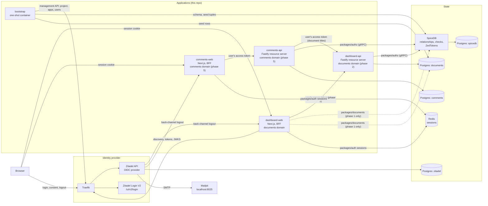

# Auth Stack Exercise — Architecture & Context

> **📜 Design/decision log.** This folder is the planning artifact for the project. Corrections are appended as dated notes (`> **YYYY-MM-DD:** ...`) that win over the surrounding text; decisions are never silently rewritten. The root `README.md` is the human-readable version of this document for someone running and reviewing the project, and it is kept in sync at the end of every phase.

> **Read this first.** This document is the shared context for every ticket and PR in this repository (`docs/TICKETS.md`). It captures the problem, the architecture, the authorization model, the consistency model, the deployment shape, the security posture, and the phase plan, so any ticket can be picked up without re-deriving context.

## 1. Problem

The system is a web application that authenticates users through a login page and, based on fine-grained permissions, lets them edit values on resources: some resources are editable, some are read-only, and some do not appear at all. Its authentication is secure, its authorization system is scalable, and the whole thing runs from a single `docker compose up`, so anyone can log in as different users and see different dashboards. The design is production-ready and the documentation is honest about it, including a list of trade-offs, shortcuts, and gaps. The design does not limit how the system can be extended, and it answers extension questions of the form "how would you add X" (enterprise SSO, provisioning, machine clients, custom roles, multi-region, swapping a component); §10 collects those answers.

## 2. Approach in one sentence

The system is a small identity platform: a self-hosted OpenID Connect provider (Zitadel) owns identities and sessions, a Zanzibar-style authorization service (SpiceDB) owns relationships and permission checks, and the application layer (a Next.js dashboard acting as a backend-for-frontend, later a Fastify API) is a thin, replaceable client of both, built from shared packages that any future service in the estate would reuse.

### Why not hand-rolled authentication

Two decisions hide in "how do users log in", and they are independent.

The first is **who handles credentials**: password storage, recovery, verification, MFA, lockout, rate limiting, breach response. Framework-provided authentication (Devise, Django's auth, Laravel's) runs fine in production for years, so "never hand-roll" is too strong. What grows with scale is the long tail around the password hash: recovery and verification flows, MFA enrolment and reset, account linking, lockout and credential-stuffing defences, audit. A dedicated identity system, bought or self-hosted, owns that tail; this project delegates it to Zitadel. The depth of the authentication work then shows in the integration surface: the OIDC client and BFF (PKCE, `state`, `nonce`, ID-token validation, cookie attributes, session lifecycle), the resource server's audience checks, just-in-time provisioning, and the threat model in §9.

The second is **how applications talk to that system**, and here OIDC is not the automatic answer. OAuth 2.0 and OIDC are a delegated-authorization framework, not a login protocol: Ory's [Before you use OAuth2](https://www.ory.com/docs/hydra/concepts/before-oauth2) puts the cases where they fit as third-party access to user data, machine-to-machine authorization, heterogeneous device fleets, and an existing investment in an OIDC product, and the cases where you likely do not need them as login, registration, recovery, social sign-in, and a new single-page or mobile app backed by your own API. For a handful of first-party apps on one domain, an identity system plus a session cookie is the simpler production shape, and it is the shape headless systems such as Ory Kratos are built for.

### Why OIDC for first-party applications here

This project still makes its first-party apps OIDC clients, for a reason that comes from experience rather than principle: an identity layer conceived without token audiences, scopes, and client registration is painful to retrofit when the first partner integration, machine client, or public API arrives, because every app's notion of "who is calling" has to change at once. Starting from one provider and OIDC clients makes those concepts exist from day one, at the cost of a redirect-based login and a BFF holding tokens. The non-OIDC alternative is available in the same stack: Zitadel's Session API lets a first-party app drive login directly and share a session cookie, which is what a custom login UI (phase 8) would use. Both shapes are documented so the trade-off is explicit instead of assumed.

## 3. Architecture



### 3.1 Components and ownership

| Component | Role | Owns | Source |
| --- | --- | --- | --- |
| Zitadel (`zitadel-api` + `zitadel-login` behind Traefik) | OpenID Provider: registration, login, MFA, password reset, IdP sessions, tokens, JWKS, back-channel logout, external IdP brokering | Identities and credentials, in its own Postgres database | Off the shelf, pinned image |
| SpiceDB | Authorization: relationships, `CheckPermission`, `CheckBulkPermissions`, `LookupResources`, ZedTokens; one schema partitioned by domain | Relationship tuples, in its own Postgres database | Off the shelf, pinned image |
| Redis | Session store behind the `SessionStore` interface of `packages/auth`, shared by every BFF | Application sessions (not IdP sessions) | Off the shelf, pinned image |
| `apps/dashboard-web` | The documents product: login redirect, session, dashboard, edit form; a BFF that holds tokens server-side | HTTP session cookie, page rendering, enforcement on its own write paths | This repo |
| `apps/dashboard-api` (phase 2) | Resource server for the documents domain behind bearer tokens | Document CRUD, enforcement on every operation | This repo |
| `apps/comments-web` and `apps/comments-api` (phase 5) | A second product, comments on documents: proves single sign-on, single sign-out, and cross-domain access | The comments domain | This repo |
| `apps/bootstrap` | One-shot, idempotent container: configures Zitadel (project, applications, seeded users), writes the SpiceDB schema, seeds the documents database and relationship tuples | Nothing at runtime; it hands generated configuration to the apps through a shared volume | This repo |
| `packages/auth` | Platform package: OIDC client for BFFs (discovery, PKCE, `state`, `nonce`, token validation), the `SessionStore` interface with in-memory and Redis adapters, the back-channel logout sink, bearer verification for APIs, the authentication-context policy helper; framework-agnostic core with thin `next` and `fastify` adapters | The one place OIDC and session details live | This repo |
| `packages/authz` | Platform package: SpiceDB client, the schema file, typed check/lookup/write helpers, consistency handling | The one place SpiceDB details live | This repo |
| `packages/db-core` | Platform package: Postgres connection factory and migration runner; no tables | | This repo |
| `packages/config` | Shared tsconfig and ESLint presets | | This repo |
| `packages/documents` | Domain package: Drizzle schema, migrations, and services for organizations, projects, documents, and the decision audit log; imported by `dashboard-web` in phase 1 and only by `dashboard-api` from phase 2 | The documents database | This repo |
| `packages/comments` (phase 5) | Domain package for comments; imported only by `comments-api` | The comments database | This repo |
| Mailpit | SMTP sink with a web UI at `localhost:8025` | Nothing | Off the shelf |

Three ownership rules shape the package layout. **One service owns each database**, so domain packages are never shared across domains, and a domain's schema travels with its services in one package. **Platform packages carry no domain tables**; `packages/auth` does not even assume a database: its `SessionStore` is an interface, and the host picks the adapter. **The IdP and the authorization service are separate processes with separate databases**, so they scale, fail, and upgrade independently, and either can be swapped (Zitadel for Auth0 or Keycloak; SpiceDB for OpenFGA) without touching the other.

### 3.2 One place per concern

Each identity concern lives in exactly one place, so that no application team has to hold the whole OIDC checklist and no component has to be rewritten when another changes: the **identity provider** (Zitadel) owns credentials, IdP sessions, and token issuance; the **in-app OIDC client** (`packages/auth`) is reduced to configuration plus a session store and is the only code that knows the protocol; the **authorization service** (SpiceDB, through `packages/authz`) owns every permission decision; the **written contract** every client follows is the configuration profile in §9; and two pieces are described for later rather than built now, an **API gateway** that validates bearer tokens in front of the APIs (until then each Fastify API validates its own) and a **session-status service** that centralizes logout propagation and revocation queries once there are more BFFs than a per-app sink can reasonably serve.

## 4. Identity: Zitadel

### 4.1 Why Zitadel

- OIDC-native (certified OP), ships a login UI with registration, password reset, MFA, and external-IdP brokering, so the login page required by the problem exists without writing one, and a custom login UI remains possible later through its Session API.
- Organizations, projects, and applications map directly onto a multi-tenant product; identity providers can be registered per organization, which is how enterprise SSO would be added (§10).
- A full management API, so the bootstrap container can configure everything; nothing is clicked in a console.
- Single Go binary plus Postgres; runs comfortably inside the reviewer's compose stack.
- Alternatives considered: Ory Kratos + Hydra (headless, so a login UI must be written, and two services instead of one); Keycloak (capable, heavier Java deployment, larger surface); Auth0 or WorkOS AuthKit (managed, cannot run inside `docker compose up`); hand-rolled (see §2). Zitadel is licensed under the AGPL, which an organization would weigh before adopting; it does not affect this project.

### 4.2 Deployment shape

The compose stack starts from Zitadel's own v4 reference compose: Traefik in front, `ghcr.io/zitadel/zitadel` (API) and `ghcr.io/zitadel/zitadel-login` (Login V2, a Next.js app served under `/ui/v2/login` on the same origin), Postgres behind. Login V2 is required in v4; the API container is configured with `ZITADEL_DEFAULTINSTANCE_FEATURES_LOGINV2_REQUIRED=true` and the `ZITADEL_OIDC_DEFAULTLOGINURLV2`/`DEFAULTLOGOUTURLV2` URLs, and the login container authenticates to the API with a login-client PAT that the API writes to a shared volume at first start (`ZITADEL_FIRSTINSTANCE_LOGINCLIENTPATPATH`). Pinned version: `v4.19.4` (the current release at the time of writing; Zitadel's own `.env.example` pins `v4.16.0`, and the spike in ticket 3 falls back to that tag if `v4.19.4` misbehaves).

The first instance is created by environment variables (`ZITADEL_FIRSTINSTANCE_*`), including a **machine user with a PAT written to the shared bootstrap volume** (`ZITADEL_FIRSTINSTANCE_PATPATH`, `ZITADEL_FIRSTINSTANCE_ORG_MACHINE_MACHINE_USERNAME`, `..._ORG_MACHINE_PAT_EXPIRATIONDATE`). The bootstrap container reads that PAT and uses the management API to create the project, the OIDC application, and the seeded users. Zitadel generates the OIDC client ID, so the bootstrap container writes the generated values (client ID, issuer) to the shared volume as an env file that `dashboard-web` sources at start. SMTP points at Mailpit through `ZITADEL_DEFAULTINSTANCE_SMTPCONFIGURATION_SMTP_HOST=mailpit:1025` (with `..._TLS=false`, `..._FROM`, and `ZITADEL_DEFAULTINSTANCE_DOMAINPOLICY_SMTPSENDERADDRESSMATCHESINSTANCEDOMAIN=false`), so verification and reset emails are visible at `http://localhost:8025`.

**One Zitadel project for the whole solution.** A project is Zitadel's security context for one software solution, and it is the unit of token audience: a JWT access token's `aud` holds the project ID plus the client IDs of every application in the project. All four applications (`dashboard-web`, `comments-web`, `dashboard-api`, `comments-api`) live in that one project, so any user-bound token issued to a client of the solution is valid at any API of the solution, which is what Zitadel intends and what the apps rely on (§6.6). Zitadel's own authorization features (project roles, role assignments, "check role assignment on authentication", project grants, organization login policies) are not used: SpiceDB owns authorization, and the apps own policy (§9). One default organization exists because the instance needs one. With a provider that models audiences per resource instead (RFC 8707 resource indicators; Auth0's "APIs" with an `audience` parameter), each API would be its own audience and each client would request the audiences it needs at login; the apps would not change, only the bootstrap.

### 4.3 The issuer and host problem

Zitadel validates that requests arrive for its configured external domain (`ZITADEL_EXTERNALDOMAIN`, `ZITADEL_EXTERNALPORT`, `ZITADEL_EXTERNALSECURE` must match the public URL, or it answers "Instance not found"), and OIDC requires the issuer string the browser is redirected to and the issuer the server discovers to be identical. In compose the browser reaches Zitadel at `localhost:8080` while the app containers reach it by service name, which breaks both. Two candidate fixes, settled by the spike in ticket 3:

- **(a) One hostname for everyone.** Use a loopback DNS name such as `auth.localtest.me` (resolves to `127.0.0.1` publicly) as `ZITADEL_DOMAIN`, publish Traefik on the host, and give the app containers `extra_hosts: ["auth.localtest.me:host-gateway"]` so the same URL works from inside containers. Simplest; requires public DNS resolution on the machine running the stack (fine for laptops and CI runners).
- **(b) Keep `localhost` and override the host.** App containers call Traefik by service name with a `Host: localhost:8080` header; `openid-client` v6 exposes a custom fetch hook that makes this possible. No DNS dependency, more code in `packages/auth`.

Only the IdP needs the shared hostname; the app's own origin stays `http://localhost:3000`, which is also what is registered as the redirect URI. For local development with Tilt, the apps run on the host (`local_resource`) while only the infrastructure runs in compose, which sidesteps the problem entirely; the reviewer path (everything in compose) is the one that has to be solved.

### 4.4 Login flow (what `packages/auth` implements)

1. `GET /auth/login` builds an authorization request: `response_type=code`, `scope=openid profile email offline_access`, PKCE `S256` (RFC 7636), fresh `state` and `nonce`, stored in a short-lived, signed, `HttpOnly` cookie; redirect to the authorization endpoint found through discovery.
2. Zitadel's login UI handles registration, password, MFA, and (later) external IdPs; it redirects back to `GET /auth/callback?code&state`.
3. The callback verifies `state`, exchanges the code with `code_verifier`, validates the ID token (`iss`, `aud`, `exp`, `nonce`, signature against JWKS) through `openid-client`, and creates a **server-side session** through the `SessionStore`: session ID, `sub`, `sid`, the tokens, the ID token's `auth_time` and `amr` (the authentication evidence used by §9), idle and absolute expiry. The browser gets only an opaque session ID in a cookie: `HttpOnly`, `Secure` (except on plain-HTTP localhost), `SameSite=Lax`, `Path=/`.
4. Just-in-time provisioning (§6.4) runs on the first login of a `sub`.
5. `POST /auth/logout` deletes the session and redirects to the `end_session_endpoint` with `id_token_hint` and a registered `post_logout_redirect_uri`, so the IdP session ends too.
6. `POST /auth/backchannel-logout` receives Zitadel's logout token (OpenID Connect Back-Channel Logout 1.0): validated like an ID token (`iss`, `aud`, `iat`, `exp`, signature), must carry `events` with `http://schemas.openid.net/event/backchannel-logout` and a `sid` or `sub`, must not carry `nonce`; the sink deletes every session with that `sid` (or every session of that `sub`). Zitadel sends it to each application's registered `backchannel_logout_uri` when the user signs out. Silent re-validation on an interval remains the backstop for notifications that never arrive.
7. Access tokens never reach the browser. A BFF attaches the session's access token when calling an API, refreshing with the refresh token when expired (rotation and reuse detection are the IdP's job).

**`SessionStore` is an interface**, not a table: `create`, `get`, `touch`, `delete`, `deleteBySid`, `deleteByUser`, `listByUser`. Two adapters ship: in-memory for tests and **Redis** for everything else. Redis gives native expiry (idle timeout as a TTL refresh, absolute lifetime as a stored field) at the cost of two secondary indexes the adapter maintains (`sid → session`, `user → sessions`) and of persistence that must be enabled or a restart logs everyone out. A relational adapter would be a drop-in; it would need an expiry cleanup job or a partial index on `expires_at`, and it would gain trivial listing and revocation queries. The core of `packages/auth` works on the Fetch API's `Request`/`Response` and depends only on `openid-client` and `jose`; `@auth-stack/auth/next` and `@auth-stack/auth/fastify` are thin adapters, so the package assumes neither a framework nor an ORM.

**APIs validate access tokens locally.** Zitadel issues JWT access tokens when the application's "Auth Token Type" is JWT; a resource server verifies the signature against JWKS, `iss`, `exp`, and that `aud` contains the project ID, with no network call per request. Introspection (RFC 7662, with the API application's own credentials) is the alternative Zitadel's guides lean on: one call per request, but it also catches revoked tokens and reports whether the caller is in the audience. The design takes local validation for latency and notes introspection as the revocation-aware option.

## 5. Resource domains and data model

Two small domains, each owned by one service and one package. The first is deliberately simple yet hierarchical enough for relationship-based access control to earn its place: **organization → project → document**. Projects, not folders: folders imply arbitrary nesting, which needs a recursive schema and buys nothing here. The second, **comments on documents** (phase 5), exists to prove single sign-on, single sign-out, and access across domains.

### 5.1 Documents domain (`packages/documents`, database `documents`)

| Table | Columns (abridged) | Notes |
| --- | --- | --- |
| `users` | `id` (Zitadel `sub`, PK), `email`, `display_name`, `created_at` | Mirror created just-in-time at first login; the IdP is the source of truth |
| `organizations` | `id`, `name`, `kind` (`personal` or `shared`), `zedtoken`, `policy` (JSON: `require_mfa`, `max_auth_age_seconds`, `require_idp`), `created_at` | `zedtoken` is the consistency anchor (§7); `policy` holds the tenant's authentication-context floors (§9) |
| `projects` | `id`, `organization_id`, `name`, `created_at` | |
| `documents` | `id`, `project_id`, `organization_id` (denormalized for filtering), `name`, `value_1`, `value_2`, `updated_at`, `updated_by` | The "values" the problem statement asks to edit |
| `authz_decisions` (phase 3) | `id`, `at`, `subject`, `action`, `resource_type`, `resource_id`, `organization_id`, `allowed`, `consistency`, `request_id`, `latency_ms` | Audit log of decisions (§8) |

### 5.2 Comments domain (`packages/comments`, database `comments`, phase 5)

| Table | Columns (abridged) | Notes |
| --- | --- | --- |
| `comments` | `id`, `document_id` (foreign key across domains by value only), `organization_id`, `author_id`, `body`, `created_at`, `zedtoken` | A comment references a document it does not own; the title is fetched from `dashboard-api` (§6.6) |

Sessions live in Redis behind `packages/auth` (§4.4), not in a domain database. Membership and roles are **not** stored in Postgres: they are relationships in SpiceDB. The domain databases store content, policy, and the consistency token; SpiceDB stores who may do what. Keeping one source of truth per concern avoids the dual-write drift that follows from storing roles in both places.

## 6. Authorization: SpiceDB

### 6.1 Why SpiceDB

- A faithful Zanzibar implementation: relationships, schema with computed permissions, `LookupResources` for "what can this user see", and **ZedTokens** with explicit consistency semantics per request (§7). This is the property the design leans on.
- Postgres datastore, single binary, runs in compose; gRPC API with an official Node client (`@authzed/authzed-node`).
- Caveats give a path to attribute-based rules without leaving the relationship model.
- Alternatives: **OpenFGA** (the same model with an HTTP API and a DSL; wider adoption; its consistency control is a per-request `HIGHER_CONSISTENCY` flag rather than a snapshot token, which is the discriminating difference for this design); **Ory Keto** (the Zanzibar model, but the project has moved slowly, and a production deployment I have seen stayed pinned to an alpha release for years because upgrading an authorization store that every product path depends on is hard: the cost of choosing the wrong engine); application-side RBAC tables (simple, but every new resource type or sharing rule becomes a schema migration and a code path, and nothing answers "list everything I can see" efficiently).

### 6.2 Schema

```zed
definition user {}

definition organization {
    relation admin: user
    relation member: user

    permission administer = admin
    permission view = admin + member
    permission create_project = admin + member
}

definition project {
    relation organization: organization
    relation owner: user
    relation editor: user
    relation viewer: user

    permission administer = owner + organization->administer
    permission edit = owner + editor + organization->administer
    permission view = owner + editor + viewer + organization->administer
    permission share = administer
}

definition document {
    relation project: project
    relation editor: user
    relation viewer: user

    permission edit = editor + project->edit
    permission view = viewer + editor + project->view
}

// Client authority (§6.7): one object per API scope; bootstrap grants scopes to first-party clients.
definition client {}

definition api_scope {
    relation granted: client

    permission use = granted
}

// Phase 5: the comments domain extends the same schema and resolves through the documents domain.
definition comment {
    relation document: document
    relation author: user

    permission view = document->view
    permission edit = author
    permission delete = author + document->edit
}
```

Design points. Organization **members** do not see projects by inheritance; only organization **admins** do. That is what makes a project "unavailable" to a member who was not added to it, which the problem statement requires. Project roles flow down to documents; direct document shares (`document#editor`, `document#viewer`) allow the read-only and editable states to differ inside one project. Roles are named bundles of relations rather than a `role` relation with string values, so a new role is a schema change reviewed like code, and permissions stay computable by `LookupResources`.

### 6.3 Seeded scenario

| User | Password (dev only) | Relationships | Dashboard |
| --- | --- | --- | --- |
| `alice@example.com` | `Password1!` | `organization:acme#admin` | Every document in Acme, all editable |
| `bob@example.com` | `Password1!` | `organization:acme#member`, `project:marketing#editor` | Marketing documents editable; Finance project absent |
| `carol@example.com` | `Password1!` | `organization:acme#member`, `project:marketing#viewer`, `document:launch-plan#editor` | "Launch plan" editable (direct share), "Budget" read-only, Finance absent |

Acme has two projects, Marketing ("Launch plan", "Budget") and Finance ("Payroll"). The structural relationships that make the arrows in §6.2 fire are seeded with them: `project:marketing#organization@organization:acme`, `project:finance#organization@organization:acme`, and `document:<id>#project@project:<id>` for each of the three documents. Carol is the reviewer's user: her dashboard shows all three states at once. Each seeded user also gets a personal workspace on first login (§6.4). The password policy is Zitadel's default (8+ characters with upper, lower, digit, symbol); seeded users are created with verified emails so no Mailpit step is needed to log in.

### 6.4 Just-in-time provisioning and the sign-up story

A user who registers through Zitadel's login UI arrives at the callback with a `sub` the app has never seen. In one transaction the app inserts the `users` row, creates a personal organization and a "Personal" project, inserts one example document, and writes the relationships `organization:<id>#admin@user:<sub>` and `project:<id>#organization@organization:<id>`, `document:<id>#project@project:<id>`. The returned ZedToken is stored on the organization. JIT beats IdP webhooks or actions for this: it cannot be missed, needs no inbound connectivity to the app, and makes the first dashboard non-empty.

### 6.5 Enforcement points

- **Dashboard:** one `LookupResources(document, view, user:<sub>)` call (it is not scoped by organization and may run at `minimize_latency`, because the next step re-verifies), join the returned IDs to `documents` rows and **group them by `organization_id`**, then one `CheckBulkPermissions` request per organization carrying that organization's `at_least_as_fresh` ZedToken and checking both `view` and `edit` for every document in the group. `view` decides whether the row is shown at all; `edit` decides between "Edit" and "Read-only". The button is a hint.
- **Edit form (GET) and save (POST):** `CheckPermission(document:<id>, edit, user:<sub>)` on the server before reading or writing. A user who posts a crafted request for a document they can only view gets `403`; one who posts for a document they cannot see gets `404` (no existence leak).
- **Phase 2:** the same checks move into `dashboard-api`; `dashboard-web` stops calling `packages/authz` directly and the API becomes the only enforcement point for resources.

### 6.6 Cross-domain access

When `comments-api` needs something about a document, three different questions have three different answers.

- **"May this user view document X?"** is asked of SpiceDB directly: `CheckPermission(document:X, view, user:<sub>)` with the documents organization's ZedToken. The comments schema references the documents schema (`comment#document@document`), so `comment.view` resolves through `document->view` without any call to `dashboard-api`. Permission questions never cross service boundaries as HTTP calls.
- **"What is document X's title?"** is data, and it travels on the **user's own access token**: `comments-api` calls `dashboard-api` with the token it received, `dashboard-api` validates it (same project, so the audience is satisfied by construction) and runs its own SpiceDB check on `sub`. The user's identity and session evidence stay attached to the request end to end. Across security contexts (a different Zitadel project, or a different provider's resource) this would be token forwarding with the wrong audience, the confused-deputy pattern; within the solution's single project it is the intended model, and the README says which is which.
- **Calls with no user** (a nightly job, a reconciliation) use a Zitadel **service user** (private-key JWT profile, or client credentials for simplicity), requesting the project audience. The receiving API authorizes the service identity itself, through relationships on a `service:<id>` subject, and never a user the caller claims to act for.

Token exchange (RFC 8693) is the textbook alternative for the second case: trade the user's token for one minted for the target API, optionally with an `act` claim naming the calling service. Zitadel supports the grant but only to keep or narrow a token's audience and scope; it cannot broaden a token from one project to another, so cross-project audiences must be requested at login with `urn:zitadel:iam:org:project:id:{projectId}:aud`. Inside one project the exchange adds nothing except the `act` claim, which requires granting impersonation rights; it is documented, not built.

### 6.7 Client authority: scopes

Two authorities have to hold for every API request, and they come from different places. **Client authority** is what the application was granted (RFC 6749 §3.3 scopes), at registration for first-party clients and at user consent for third-party ones. **User authority** is what the person may do, which SpiceDB decides. The effective permission is their intersection, and the API enforces both, in that order: the bearer plugin checks the scope first (`requireScope('documents:write')`, failing with `403` and `WWW-Authenticate: Bearer error="insufficient_scope"` per RFC 6750 §3.1), then the handler runs the SpiceDB check on `sub`. Without the first gate, any client that obtains a user's token holds the user's full authority, which is exactly what scopes exist to prevent once external clients appear.

Each API publishes a scope vocabulary and enforces it from its first version, so that external clients can be added later without touching the APIs:

| API | Scopes |
| --- | --- |
| `dashboard-api` | `documents:read`, `documents:write` |
| `comments-api` | `comments:read`, `comments:write` |

First-party clients request every scope of every API they call, so for them the gate is always open. A third-party client requests the subset it needs and the user consents to it; a token exchange can only narrow the set further.

> **⚠️ Disclaimer: this is a workaround for a vendor limitation, not the intended design.** Client authority belongs in the authorization server: the provider defines the scopes, shows the consent screen, and puts the granted `scope` in the access token, and the API reads it from there. Zitadel does neither (see the vendor gap below), so this project stores client-to-scope grants in SpiceDB and resolves them by `azp`. It does this for one reason: so that the APIs enforce a scope gate from their first version and never have to be retrofitted when the stack grows third-party clients. The moment the provider emits `scope`, the `fromScopeClaim` resolver replaces the SpiceDB-backed one and the `client`/`api_scope` tuples are deleted; the APIs do not change.

**Where client authority is stored (under this workaround).** In SpiceDB, like every other "who may do what" fact, with the client as the subject: `api_scope:documents_write#granted@client:<azp>`. Bootstrap writes those relationships for every first-party client and every scope; registering a new client is one more set of tuples. There is no per-API client registry: the bearer plugin resolves a client's effective scopes with one `LookupResources(api_scope, use, client:<azp>)`, cached per client for a minute because client authority changes rarely, and the APIs share that single store.

**How `packages/auth` resolves scopes without owning the store.** Through an interface, as with sessions: `ScopeResolver.resolveScopes(claims) → Set<string>`. Two implementations: `fromScopeClaim`, for providers that put `scope` in access tokens, and a `packages/authz`-backed resolver that runs the lookup above, wired in by the API at startup so `packages/auth` depends on neither SpiceDB nor a database.

**Vendor gap.** Zitadel does not, as far as its documentation and community threads show, support custom scopes or a consent screen, and its claims matrix shows no `scope` claim in any token type; JWT access tokens do carry `azp` ("client id of the client who requested the token"; introspection reports it as `client_id`). So with Zitadel the SpiceDB-backed resolver keyed by `azp` is the only source of client authority. Zitadel can register third-party applications and issue them user tokens, but without consent and scopes it cannot run a real third-party program; that would take a provider that does (Auth0, Keycloak) or a second authorization server such as Ory Hydra federated to Zitadel for login. Because the APIs already enforce the gate and the store is central, that is a provider change, not an API change, which is the point of building the gate now.

## 7. Consistency: ZedTokens and the New Enemy problem

Authorization data is replicated and cached, so a check may run against a snapshot older than the latest write. The Zanzibar paper names two failures that follow: (1) **neglecting update order** — Alice removes Bob from a project and then adds a document; a check served from a snapshot between the two still lets Bob see the new document; (2) **applying an old ACL to new content** — Bob is removed, content is added, and Bob's check against the older snapshot passes. SpiceDB's default consistency, `minimize_latency`, permits both windows.

The remedy is the snapshot token: every `WriteRelationships` returns a **ZedToken** marking the datastore revision after the write. The application stores it next to the protected data and passes it back as `at_least_as_fresh` on `CheckPermission`, `CheckBulkPermissions`, and `LookupResources`. The check then sees at least the revision in which that data's permissions were last written, without forcing `fully_consistent` on every call.

**Granularity decision.** ZedTokens are opaque to clients, so two tokens cannot be compared or merged; a check can carry only one. The token therefore lives at the **organization**, the tenancy boundary: every relationship write under an organization (membership, project roles, document shares, new documents) updates `organizations.zedtoken`, and every check or lookup for a resource in that organization uses it. The cost is one extra read of the organization row per request, which the request already loads for scoping. It also dictates the dashboard's shape: `CheckBulkPermissions` carries a single `consistency` field for the whole request, so documents are grouped by organization and checked one organization at a time, each group with its own token (§6.5). Alternatives rejected: a per-document token (finer, but membership changes on the project would have to fan out to every document's token to close case 2), and `fully_consistent` on every check (correct and simplest, but it bypasses the cache on the hot path and on some datastores still does not guarantee read-after-write). `at_exact_snapshot` is used nowhere; it exists for paginating a stable view.

## 8. Audit and observability

Every enforcement point records a **decision** (phase 3): who, what action, which resource, in which organization, the outcome, the consistency mode used, the request ID, and latency. A decision is the application's conclusion; a **check** is a SpiceDB call. They differ in count (one dashboard decision is backed by one lookup and one bulk check) and some decisions never reach SpiceDB (no session: deny). Decisions go to the `authz_decisions` table and are queryable per organization, which is the shape a customer-facing "who could do what" view needs. Checks are recorded as OpenTelemetry spans with the consistency mode as an attribute (phase 5), alongside HTTP and database spans, exported over OTLP to a collector in a compose profile.

## 9. Security posture (the configuration profile)

| Concern | Decision |
| --- | --- |
| Credentials | Never handled by the apps. Zitadel stores password hashes (its default policy; bcrypt-family, configurable), rate-limits login attempts, and runs lockout, verification, and password-reset flows. The apps never see a password. |
| Session cookie | Opaque ID to a server-side session in Redis; `HttpOnly`, `SameSite=Lax`, `Secure` outside localhost, no `Domain` attribute. Idle timeout and absolute lifetime enforced in the store. Logout deletes the session and ends the IdP session; back-channel logout deletes it when the user signs out elsewhere. |
| OIDC client | Authorization code + PKCE `S256`; `state` and `nonce` single-use and bound to the login attempt; exact-match redirect URIs registered in Zitadel; ID token validated by `openid-client` (`iss`, `aud`, `exp`, `nonce`, signature). Tokens never leave the server. |
| CSRF | State-changing routes accept `POST` only, check `Origin`/`Sec-Fetch-Site` against the app origin, and (phase 4) carry a per-session CSRF token in forms. `SameSite=Lax` is the first line, not the only one. |
| Authorization | Server-side on every read and write path (§6.5); deny by default; `404` for unseen resources, `403` for seen-but-forbidden. |
| Authentication-context policies | Enforced by the apps, never by the IdP (see below). |
| Token scopes | Every API enforces its scope vocabulary in the bearer plugin before any business logic (§6.7); first-party clients hold all scopes, external clients the subset they were granted; effective permission is scope ∩ SpiceDB. Client-to-scope grants live in SpiceDB only as a workaround for Zitadel's lack of custom scopes; the gate exists so the APIs need no retrofit when a provider with scopes and consent arrives. |
| Input | Validated with a schema (zod) at the route boundary; document values and comment bodies are bounded strings; IDs are opaque. |
| Headers | `Content-Security-Policy` (no inline scripts), `X-Content-Type-Options`, `Referrer-Policy`, `Frame-Options`/`frame-ancestors`, HSTS behind TLS (phase 4). |
| Rate limiting | Zitadel on authentication; app-level limits on the callback, the back-channel logout sink, and mutations (phase 4). |
| Secrets | Development defaults committed on purpose (zero-step start); labelled insecure; `.env.example` documents each; Gitleaks in CI; production would inject from a secret store. |
| Logging | Request IDs everywhere; no tokens, session IDs, or passwords in logs. |
| Dependencies | Lockfile committed; `pnpm audit` in CI (non-blocking at first). |
| Transport | Plain HTTP on localhost by design; TLS terminates at Traefik in any real deployment (Zitadel's compose overlays show the modes). |

### 9.1 Authentication-context policies live in the apps

Policies such as "this tenant requires MFA", "this tenant requires login through its own IdP", or "editing payroll needs a login within ten minutes" are statements about the session's quality, not about the resource's permissions, and this design enforces all of them at the application layer rather than in the IdP. The reason is the one GitHub's organization SAML model makes visible: one account can belong to several tenants with different policies, and the IdP cannot know at login time which tenant's resources a session will touch. So the policy is stored on the app-level organization (`organizations.policy`), evaluated by the resource server or BFF when a request touches that organization's resources, and when the session's evidence is insufficient the response is the step-up challenge of RFC 9470 (`401`, `WWW-Authenticate: Bearer error="insufficient_user_authentication"` with the required `acr_values` or `max_age`); the client re-authenticates at the IdP with `prompt=login` and the organization's IdP hint, then retries. A gateway can enforce only what the token alone decides (signature, audience); it never holds tenant policy.

The decision has a cost and a dependency. The cost: a session that violates a tenant's floor can exist; it just cannot touch that tenant's resources, which is the same guarantee GitHub gives. The alternative, Zitadel's per-organization login policies (`ForceMFA`, external-IdP-only), would enforce at login but only for the user's home organization and only with this vendor; the design does not use them, which keeps the IdP replaceable. The dependency: the resource server needs the evidence. RFC 9068 (JWT access tokens) defines `auth_time`, `acr`, and `amr` as optional claims for exactly this purpose, and that makes it a criterion for choosing a provider: *emits RFC 9068 access tokens with `auth_time`, `amr`, and `acr`*. Zitadel does not meet it out of the box: those claims appear only in its ID token, not in access tokens, userinfo, or introspection. In this project the BFF therefore keeps `auth_time` and `amr` from the ID token in the session and enforces its own app's policies there through `requireAuthContext({ maxAge, amr })` from `packages/auth`; whether a Zitadel Action can add the claims to access tokens, which would let the APIs enforce cross-app policies as designed, is a spike in phase 5, and if it cannot, the limitation is recorded in the README. Forwarding the ID token to an API as evidence is ruled out: its `aud` is the client, and an API accepting a token not minted for it is the pattern `aud` exists to prevent.

## 10. Extension paths (the questions this design is built to answer)

- **Enterprise SSO (SAML, OIDC federation):** the customer's IdP is registered as an external identity provider in Zitadel (Zitadel acts as the SAML service provider or OIDC relying party); the app-level organization records which IdP its users must come through, and the BFF passes that as a login hint when a user heads for that organization (Zitadel accepts an IdP or organization scope on the authorization request). The requirement itself is enforced as a §9.1 policy on access, not by the IdP at login, so the apps stay vendor-neutral while the hint remains provider-specific. A multi-tenant SSO broker (WorkOS, Ory Polis) can sit upstream the same way, with the tenant selected before the redirect, which is why the IdP registry is per organization.
- **SCIM provisioning:** a small worker consuming directory webhooks (or Zitadel's SCIM endpoint, currently a preview feature) that creates users through the management API and maps directory groups to `organization#member` and `project#<role>` relationships. This worker is the first auth-service-style app the monorepo would gain.
- **Service-to-service access:** permission questions go to SpiceDB; data on a user's behalf travels on the user's token within the solution's security context; calls with no user use a service user with its own relationships (§6.6). Across security contexts, token exchange (RFC 8693) with an `act` claim is the textbook shape; with Zitadel it narrows but never broadens an audience, so cross-project audiences are declared at login.
- **External OAuth clients:** a third-party application holding `documents:read` only calls the same APIs with a user's token; the scope gate (§6.7) refuses writes with `insufficient_scope` while SpiceDB still decides which documents the user may read. Its client authority is a set of `api_scope` tuples; consent and provider-issued scopes require a provider that supports them (Auth0, Keycloak, or Ory Hydra federated to Zitadel), and nothing in the APIs changes when that provider arrives.
- **Machine-to-machine access and API keys:** service users on Zitadel (private-key JWT profile or client credentials) for services, and API keys stored by the app that exchange into short-lived tokens; all end up as `user:<id>` or `service:<id>` subjects in SpiceDB.
- **Custom roles, hierarchies, ABAC:** new relations and permissions in the schema (reviewed like code); nested organizations through `organization#parent` with `parent->administer` arrows; attribute rules through SpiceDB caveats (time windows, IP ranges, plan tiers).
- **A third application:** `packages/auth` plus one adapter, one OIDC application registered by bootstrap, one `backchannel_logout_uri`; the second application (phase 5) is the proof of how little that takes.
- **An API gateway:** Traefik ForwardAuth or Envoy `ext_authz` in front of the APIs, verifying bearer tokens and injecting the subject, so individual services stop validating tokens; configuration, not code. It cannot hold tenant policy (§9.1).
- **Logout propagation:** the back-channel logout sink is already in every BFF (§4.4); at estate scale it becomes one shared session-status service that every BFF queries, with the IdP notifying one endpoint instead of many.
- **Multi-region:** SpiceDB on CockroachDB or Spanner for a global relationship store with the same ZedToken semantics; the domain databases partitioned by organization; Redis sessions per region with the session ID carrying its region; the IdP replicated with Zitadel's multi-region guidance. Permission checks stay local to the region that holds the relationships, with `at_least_as_fresh` preventing cross-region staleness from becoming a New Enemy.
- **Swapping the IdP:** everything the apps know about Zitadel is the issuer URL, a client registration, and the project-shaped audience; `packages/auth` works from discovery, and tenant policy never lived in the IdP. Swapping to Auth0 or Keycloak is bootstrap work plus the audience mapping (§4.2), not app work.
- **Swapping the authorization engine:** `packages/authz` is the only SpiceDB-aware code; OpenFGA has the same model minus snapshot tokens, so §7 would be rewritten around its consistency flag.

## 11. Phase plan

The order follows one principle: the earliest end-to-end working slice first, then widen, with the least important work last. Anything not reached is documented as future work in the root README, which the problem statement explicitly asks for.

| Phase | Delivers | Why in this position |
| --- | --- | --- |
| 0 — Foundation | Monorepo scaffold, compose stack (Postgres, Zitadel + login, Traefik, SpiceDB, Redis, Mailpit), the Zitadel spike (host mapping, one real login), bootstrap container, Tiltfile, CI skeleton | Everything else depends on a login that works from inside compose |
| 1 — Vertical slice | SpiceDB schema and `packages/authz`, `packages/db-core` and `packages/documents`, `packages/auth` BFF with the Redis session store, JIT provisioning, dashboard with the three states, edit flow with server-side enforcement, seeded users, Playwright login-and-edit test, root README v1 | **Minimum viable submission:** phase 1 plus the README satisfies every hard requirement |
| 2 — Resource server | `dashboard-api` on Fastify verifying bearer tokens (JWKS, `iss`, `aud`); `dashboard-web` calls it with the session's access token; `packages/documents` moves behind the API | Same service code, new host: low cost, and it is the "how would you add a second app" answer |
| 3 — Consistency and audit | ZedToken on organizations with `at_least_as_fresh` everywhere; `authz_decisions` table and a per-organization audit page | The design's strongest talking point, made real |
| 4 — Hardening | CSRF tokens, security headers and CSP, rate limits, input validation audit, `requireAuthContext` policies on the seeded organizations, Gitleaks and `pnpm audit` in CI, unit and integration tests filled out, README trade-offs section | Security reviewers read this phase |
| 5 — Second application | `comments-web` and `comments-api` on the platform packages; back-channel logout sink; single sign-on and single sign-out proven end to end; cross-domain access per §6.6; the Zitadel Actions spike for RFC 9068 claims | The identity story only proves itself with a second client |
| 6 — Observability | OpenTelemetry tracing across web, APIs, SpiceDB and Postgres calls; collector and Jaeger in a compose profile | Cheap once the structure exists |
| 7 — Kubernetes | Kustomize or Helm manifests, a `kind` cluster, a second Tiltfile for Kubernetes | Production-like deployment; optional, documented if unreached |
| 8 — Gateway | Traefik ForwardAuth or Envoy `ext_authz` in front of the APIs | Configuration-only demonstration of gateway-level token validation |
| 9 — Identity extensions | A second OIDC provider brokered through Zitadel (SSO demo); optionally a custom login UI on the Session API | Shows the extension paths in §10 running |

## 12. Decision log

> **2026-10-13:** Initial decisions recorded in this document: Zitadel over Kratos + Hydra; SpiceDB over OpenFGA and Keto; organization → project → document (projects, not folders); server-side sessions in Postgres with an opaque cookie; ZedToken stored per organization; compose first, Tilt wraps compose, Kubernetes last; TypeScript monorepo with pnpm workspaces, Jest, Playwright; minimal UI; Mailpit in compose; three seeded users plus JIT personal workspaces; development secrets committed and labelled.

> **2026-10-14:** Second application (comments on documents) added as phase 5 to prove single sign-on, single sign-out, and cross-domain access; observability and later phases shift by one. Packages reshaped: per-domain packages (`documents`, `comments`) own schema, migrations, and services together; platform packages (`auth`, `authz`, `db-core`, `config`) carry no domain tables; `packages/auth` exposes a `SessionStore` interface with in-memory and Redis adapters and framework adapters for Next.js and Fastify, replacing the Postgres `sessions` table. One Zitadel project holds all applications (Zitadel's intended model; its roles, grants, and login policies are unused). Authentication-context policies (MFA, IdP, login recency) are enforced by the apps per organization with RFC 9470 step-up, not by the IdP, to keep the stack vendor-neutral; RFC 9068 claims in access tokens recorded as a provider-selection criterion Zitadel does not meet out of the box. Zitadel's back-channel logout confirmed as supported without a feature flag.

> **2026-10-14 (later):** Client authority added as §6.7: APIs enforce a scope vocabulary in the bearer plugin from their first version, independently of SpiceDB's user authority, so external OAuth clients can be added without changing the APIs. Client authority is stored centrally in SpiceDB (`api_scope#granted@client`) and resolved through a `ScopeResolver` interface in `packages/auth`, keyed by Zitadel's `azp` claim; Zitadel's lack of custom scopes and consent recorded as a vendor gap. A sample external client was considered and dropped: without consent and provider-issued scopes it would only exercise the registry.
